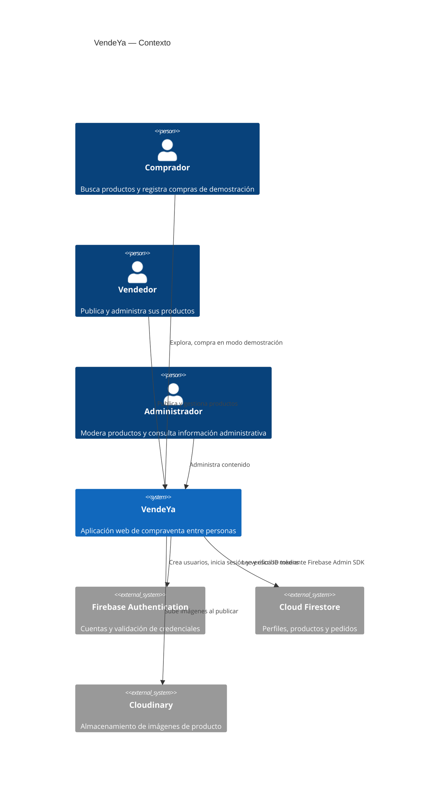
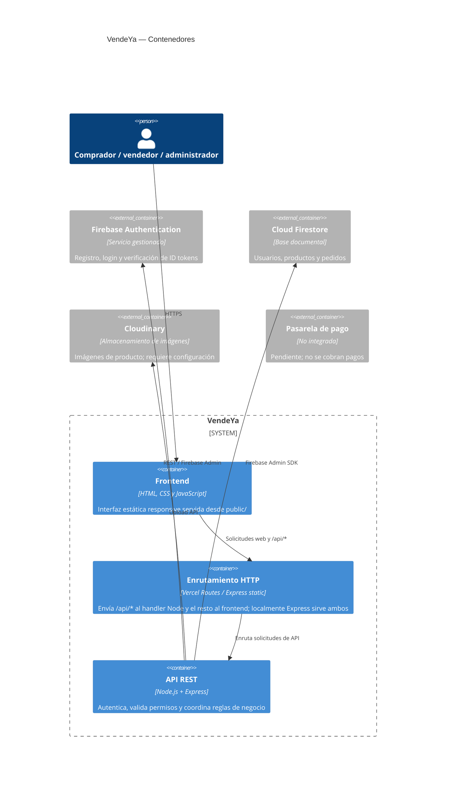
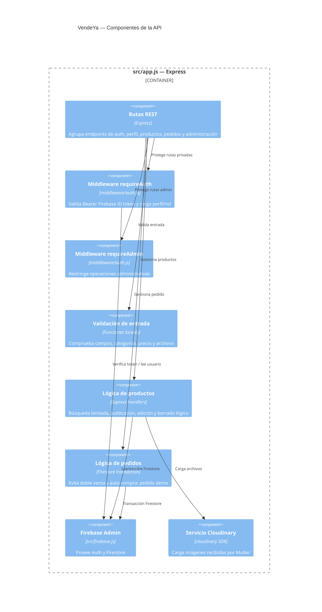
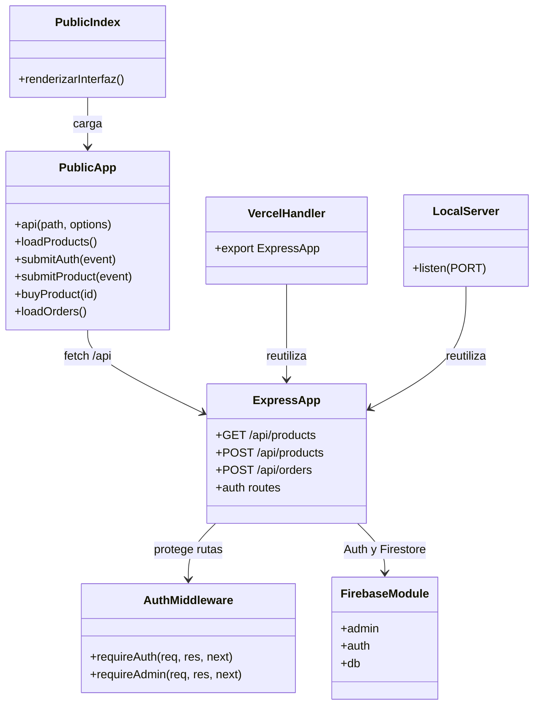

# TALLER 1 — SISTEMA COMPLEJO: CONSTRUCCIÓN Y DESARROLLO DE SOFTWARE

## Arquitectura C4, desarrollo de endpoints REST, frontend web y despliegue en Vercel de VendeYa

**Estudiante:** ______________________________  
**Docente:** ______________________________  
**Asignatura:** Sistema Complejo: Construcción y Desarrollo de Software  
**Institución:** ______________________________  
**Fecha:** ______________________________

## 1. Objetivo general

Construir una plataforma web VendeYa donde las personas puedan descubrir productos, publicar artículos y registrar compras demostrativas mediante una API autenticada y una persistencia en Firestore.

### Objetivos específicos

- Integrar Firebase Authentication con validación de ID tokens en el backend.
- Exponer endpoints REST para perfiles, productos, pedidos y administración.
- Presentar una interfaz en español adaptable a distintos tamaños.
- Documentar arquitectura C4, configuración local y despliegue serverless.
- Separar con claridad las compras de demostración de pagos reales.

## 2. Idea de negocio e historias de usuario

VendeYa conecta a compradores y vendedores particulares para dar una segunda oportunidad a productos disponibles. La frase de marca es “Compra local, vende fácil”.

- **HU-01 Cuenta:** una persona crea su cuenta, inicia sesión y cierra su sesión; Firebase Authentication gestiona las credenciales y la API verifica el token.
- **HU-02 Venta:** una persona autenticada publica un artículo con título, descripción, precio, categoría e imágenes; puede retirar su propia publicación.
- **HU-03 Búsqueda:** cualquier visitante busca productos por texto y filtra por categoría, rango de precio y disponibilidad; el catálogo pagina los resultados.
- **HU-04 Compra:** una persona consulta el detalle y registra un pedido demostrativo de un producto disponible. El comprador y el vendedor pueden consultar el pedido; no se procesa dinero.

## 3. Tecnologías y justificación

| Tecnología | Uso real |
|---|---|
| HTML, CSS y JavaScript | Interfaz estática en `public/`; lógica de UI y llamadas fetch en `public/app.js`. |
| Node.js y Express | API REST, servidor local y handler exportado a Vercel. |
| Firebase Authentication | Registro, login, Firebase ID token JWT y verificación. |
| Cloud Firestore + Firebase Admin SDK | Perfiles, catálogo y pedidos; operaciones del servidor omiten reglas cliente y pasan por la API. |
| Multer y Cloudinary | Recepción limitada y carga de imágenes cuando las variables de Cloudinary existen. |
| Helmet | Cabeceras HTTP de seguridad. |
| Vercel | `api/index.js` como función Node y rutas de archivos estáticos configuradas en `vercel.json`. |

No se integra una pasarela de pagos; el flujo de pedidos es explícitamente demostrativo. La búsqueda usa palabras normalizadas e índices compuestos de Firestore, con coincidencia exacta de tokens. Debe ejecutarse el backfill indicado en API.md para indexar productos antiguos.

## 4. Arquitectura multicapa y proxy inverso

1. **Presentación:** HTML, CSS modular y JavaScript.
2. **Acceso:** Vercel enruta `/api/*` a `api/index.js`, y los demás recursos a `public/`. En local, Express sirve estáticos y API en el mismo puerto.
3. **Aplicación:** handlers Express y reglas de negocio en `src/app.js`.
4. **Seguridad:** Firebase ID tokens, middleware `requireAuth`/`requireAdmin`, validaciones, Helmet y reglas Firestore cliente denegadas.
5. **Datos:** Firestore mediante Admin SDK.
6. **Servicios externos:** Firebase Authentication y Cloudinary. Pasarela de pago pendiente.

## 5. Arquitectura C4

Los cuatro archivos Mermaid independientes y sus explicaciones están en [`architecture/`](architecture/). C1 presenta actores y sistemas externos; C2 muestra frontend, routing/API, Firebase y Cloudinary; C3 representa componentes; C4 emplea un diagrama de módulos/clases porque Mermaid no define un diagrama normativo de código C4.

**Acceso local a diagramas:** [`docs/architecture/`](architecture/). **Enlace público de Mermaid.ai:** pendiente; la herramienta de navegador de esta sesión no inició correctamente, por lo que no afirmo haber publicado ni compartido diagramas. Los códigos fuente completos quedan anexados y se pueden importar en Mermaid.ai.

## 6. Endpoints y código

La especificación de método, ruta, objetivo, historia, encabezados/cuerpo, autorización, validación, respuesta, errores, ejemplos y esfuerzo está en [`API.md`](API.md). La documentación incluye contratos y ejemplos. El código íntegro y organizado por archivos se adjunta en los anexos B–Q, y coincide con la versión revisada del proyecto.

## 6.1 Especificación completa de endpoints

Base local `http://localhost:3000`; producción usa el dominio de Vercel. JSON usa `Content-Type: application/json`. Rutas privadas requieren `Authorization: Bearer <Firebase ID token>`. Los errores usan `{ "error": "..." }`.

| Método y ruta | HU / propósito | Parámetros y cuerpo | Autenticación y validación | Respuesta y errores | Esfuerzo |
|---|---|---|---|---|---|
| `POST /api/auth/register` | HU-01 crea cuenta/perfil y sesión. | `{name,email,password,phone}`. | Público. Email, nombre, teléfono y contraseña fuerte; Firebase garantiza unicidad. | `201 {uid,idToken,refreshToken,expiresIn,user}`; `400`, `409`, `503`. | Medio: Firebase Auth, perfil y token. |
| `POST /api/auth/login` | HU-01 inicia sesión. | `{email,password}`. | Público. Valida credenciales vía Firebase Identity Toolkit; requiere `FIREBASE_WEB_API_KEY`. | `200 {idToken,refreshToken,expiresIn,uid,user}`; `400`, `401`. | Medio. |
| `GET /api/users/me` | HU-01 consulta el perfil. | Header Bearer. | Token válido; UID se deriva del token. | `200 {user}`; `401`, `404`. | Bajo. |
| `PUT /api/users/me` | Actualiza datos del perfil. | `{name,phone}`. | Dueño según token; campos validados. | `200 {mensaje}`; `400`, `401`. | Bajo. |
| `GET /api/categories` | HU-03 lista categorías. | Sin cuerpo. | Pública. | `200 {categories}`. | Bajo. |
| `GET /api/products` | HU-03 busca, filtra y pagina. | Query `search,category,minPrice,maxPrice,page,limit`. | Pública. Precios válidos, página positiva, límite 1–50. Usa tokens de búsqueda e índices compuestos Firestore. | `200 {products,pagination}`; `400`, `500`. | Medio: índices y migración de documentos existentes. |
| `GET /api/products/:id` | HU-03 consulta detalle. | ID en ruta. | Pública; productos retirados se ocultan. | `200 {product}`; `404`. | Bajo. |
| `POST /api/products` | HU-02 publica. | Multipart: `title,description,category,price,images[]`. | Bearer requerido; UID vendedor del token, imagen JPG/PNG/WebP hasta 5 MB, máximo 5. Cloudinary configurado. | `201 {mensaje,productId,images}`; `400`, `401`, `503`. | Medio. |
| `PUT /api/products/:id` | HU-02 edita publicación. | Campos parciales permitidos. | Propietario o admin; vendedor no puede cambiar dueño ni modificar producto vendido. | `200 {mensaje}`; `400`, `401`, `403`, `404`, `409`. | Bajo. |
| `DELETE /api/products/:id` | HU-02 retiro lógico. | ID en ruta. | Propietario o admin. | `200 {mensaje}`; `401`, `403`, `404`. | Bajo. |
| `POST /api/orders` | HU-04 registra pedido demo. | `{productId,deliveryAddress,paymentMethod:"demo"}`. | Bearer; dirección 8–300 caracteres, producto disponible y no propio. Transacción previene doble venta. | `201 {mensaje,orderId}`; `400`, `401`, `404`, `409`. Sin cobro real. | Alto. |
| `GET /api/orders` | Consulta compras/ventas. | Bearer. | El backend filtra por buyer, seller o admin. | `200 {orders}`; `401`. | Bajo. |
| `GET /api/orders/:id` | Consulta un pedido. | ID y Bearer. | Comprador, vendedor asociado o admin. | `200 {order}`; `401`, `403`, `404`. | Bajo. |
| `GET /api/admin/users` | Administración de perfiles (máx. 300). | Bearer. | Solo rol admin. | `200 {users}`; `401`, `403`. | Bajo. |
| `PUT /api/admin/products/:id` | Administración cambia estado. | `{status:"available"|"sold"|"deleted"}`. | Solo admin. | `200 {mensaje}`; `400`, `401`, `403`, `404`. | Bajo. |
| `GET /api/admin/orders` | Administración consulta pedidos (máx. 300). | Bearer. | Solo admin. | `200 {orders}`; `401`, `403`. | Bajo. |
| `GET /api/health`, `GET /api/firebase-check` | Estado de API y Firestore. | Sin cuerpo. | Públicas. | `200`; el segundo requiere conectividad Firebase. | Bajo. |
| `POST /api/payments`, `POST /api/payments/webhook`, `POST /api/shipments`, `GET /api/shipments/:id` | Integraciones futuras. | Según proveedor. | Pago y logística real aún no están configurados. | `501`; no finge cobros. | Alto. |
| `POST /api/notifications` | Guarda notificación. | `{message}` de 2–500 caracteres. | Bearer. | `201 {mensaje,notificationId}`; `400`, `401`. | Bajo. |

## Ejemplos de solicitud y respuesta

### Registro con token Firebase

```http
POST /api/auth/register
Content-Type: application/json
```

```json
{"name":"Ana Pérez","email":"ana@example.com","password":"ClaveSegura9","phone":"3001234567"}
```

```json
{"uid":"UID_FIREBASE","idToken":"FIREBASE_ID_TOKEN","refreshToken":"FIREBASE_REFRESH_TOKEN","expiresIn":"3600","user":{"uid":"UID_FIREBASE","email":"ana@example.com","name":"Ana Pérez","role":"user"}}
```

### Búsqueda paginada

```http
GET /api/products?search=audifonos&category=Tecnología&minPrice=10000&maxPrice=250000&page=1&limit=12
```

```json
{"products":[],"pagination":{"page":1,"limit":12,"total":0,"pages":1,"capped":false}}
```

### Publicación con imágenes

```http
POST /api/products
Authorization: Bearer FIREBASE_ID_TOKEN
Content-Type: multipart/form-data
```

Campos: `title`, `description`, `category`, `price` y de 1 a 5 archivos `images`.

```json
{"mensaje":"Producto publicado correctamente.","productId":"ID_FIRESTORE","images":["https://res.cloudinary.com/.../producto.jpg"]}
```

### Pedido demostrativo

```http
POST /api/orders
Authorization: Bearer FIREBASE_ID_TOKEN
Content-Type: application/json
```

```json
{"productId":"ID_FIRESTORE","deliveryAddress":"Calle 10 # 20-30, Bogotá","paymentMethod":"demo"}
```

```json
{"mensaje":"Pedido demostrativo registrado; no se procesó un pago real.","orderId":"ID_PEDIDO"}
```

## Búsqueda e índices

Se indexan palabras normalizadas de título, descripción y categoría en `searchKeywords`. Firestore combina esa búsqueda exacta por token con filtros de categoría/precio y orden descendente de creación. `firestore.indexes.json` declara las combinaciones; despliega índices con `firebase deploy --only firestore:indexes`. Para productos ya almacenados ejecuta primero `node scripts/reindex-products.js` para revisar cuántos faltan y luego `npm run index:products` para aplicar el backfill. El backfill modifica datos Firestore, por eso se entrega como comando separado y no se ejecuta durante esta revisión. No se ofrece búsqueda semántica, tolerancia a errores ortográficos ni coincidencia por prefijos.

## Implementación fuente

Handlers REST: `src/app.js`. Normalización y palabras de búsqueda: `src/search.js`. Autorización: `middleware/auth.js`. Inicialización Firebase: `src/firebase.js`. Función Vercel: `api/index.js`.


## 7. Frontend

- `public/index.html`: portada, catálogo, filtros, formulario de publicación, autenticación y pedidos.
- `public/styles.css`: hoja de entrada que importa estilos organizados en `public/styles/`.
- `public/app.js`: sesión de navegador, validación en tiempo real, registro/login, detalle de producto, checkout demostrativo, filtros indexados, paginación, publicación y vistas de compras/ventas.
- `src/app.js`: backend Express, incluyendo endpoints REST.

Las imágenes de publicación se validan en cliente y servidor. El frontend ofrece estados de carga y error. Las compras indican explícitamente que no hay cobro real.

## 8. Instalación local y variables

1. Instala Node.js 20 o superior.
2. En la carpeta del proyecto ejecuta `npm install`.
3. Copia `.env.example` a `.env` y completa credenciales privadas fuera del repositorio.
4. En Firebase activa Email/Password y configura Firestore.
5. Para imagen, configura `CLOUDINARY_CLOUD_NAME`, `CLOUDINARY_API_KEY` y `CLOUDINARY_API_SECRET`.
6. Ejecuta `npm start` y abre `http://localhost:3000`.
7. Verifica `GET /api/health` y, con credenciales válidas, `GET /api/firebase-check`.

Variables: `GOOGLE_APPLICATION_CREDENTIALS` (local), `FIREBASE_SERVICE_ACCOUNT_JSON` (alternativa para Vercel), `FIREBASE_WEB_API_KEY` (login), las tres variables Cloudinary y opcionalmente `PORT`. Nunca subas `.env` o el JSON de cuenta de servicio.

## 9. Despliegue en Vercel

1. Publica el repositorio en GitHub sin `.env` ni el JSON de servicio.
2. En Vercel importa el repositorio y establece `VendeYa/` como raíz, donde viven `vercel.json`, `api/` y `public/`.
3. Configura `FIREBASE_SERVICE_ACCOUNT_JSON`, `FIREBASE_WEB_API_KEY`, `CLOUDINARY_CLOUD_NAME`, `CLOUDINARY_API_KEY` y `CLOUDINARY_API_SECRET` en Environment Variables.
4. Despliega y verifica `/api/health`, registro/login, catálogo y publicación con una cuenta de prueba. Para Firebase ejecuta desde el directorio superior `firebase deploy --only firestore:rules,firestore:indexes`; ejecuta el backfill solamente después de revisarlo.
5. La pasarela no tiene credenciales ni implementación real; el checkout informa que no hay cobro.

El proyecto quedó preparado, pero no se publicó desde esta sesión ni se afirma que Vercel haya desplegado correctamente.

## 10. Pruebas y evidencias

**Pruebas ejecutadas:** `npm test` desde la carpeta superior ejecutó 9 pruebas: normalización de tokens, correspondencia de IDs frontend, emisión de token, autenticación de endpoints privados, checkout, búsqueda indexada, transacción de compra/autocompra y reglas Firestore. Resultado: 9 aprobadas, 0 fallidas. `node --check` pasó para los archivos JavaScript principales y los JSON de paquetes/Vercel se pudieron parsear. `GET /api/health` respondió `estado: ok` en puerto 3100. La solicitud real al catálogo expiró al consultar Firestore en este entorno; `page=0` fue rechazado. Firestore indexes y el backfill deben desplegarse/aplicarse al proyecto antes de evaluar búsquedas indexadas. El puerto 3000 ya estaba ocupado por otro proceso que respondió health, por eso el servidor actualizado se levantó en 3100 y luego se cerró. No se ejecutaron flujos de login/registro, Cloudinary ni Vercel porque requieren credenciales/servicios externos.

Pendiente de evidencia: captura del catálogo y autenticación en navegador; respuestas HTTP con Firebase configurado; publicación con Cloudinary; compra demo con Firestore; URL de despliegue Vercel y enlace Mermaid.ai compartido.

## 11. Limitaciones conocidas

- La pasarela de pago no está integrada; el pedido usa `paymentStatus: not_integrated`, registra una demostración y no equivale a una transacción pagada.
- La búsqueda usa tokens exactos de `searchKeywords`; no ofrece prefijos, sinónimos ni tolerancia ortográfica. Las consultas combinadas dependen de que los índices compuestos se hayan desplegado. La paginación por offset puede encarecer páginas profundas. Los documentos anteriores deben indexarse con el backfill.
- Cloudinary debe configurarse para publicar imágenes; no hay almacenamiento local de respaldo.
- Las pruebas smoke se ejecutan con `npm test`; requieren Node.js 20 o superior.
- El despliegue depende de variables y credenciales Firebase válidas que debe aportar el propietario.

## 12. Conclusiones y sustentación

La solución usa una arquitectura multicapa donde el frontend nunca decide el UID del vendedor y el registro devuelve un ID token de Firebase. Los pedidos de demostración validan disponibilidad en una transacción, pero no sustituyen una confirmación de pago real. Para sustentar: explicar el flujo token Firebase → middleware → Firestore; demostrar validación de registro, filtros, detalle y publicación; mostrar cómo el backend aplica propiedad y autorización; y aclarar que el pedido es demostrativo, sin pago. Como siguiente entrega, desplegar índices y backfill, publicar los diagramas en Mermaid.ai, verificar Vercel y conectar una pasarela cuando el comercio tenga credenciales.


## Anexo A Código Mermaid de las cuatro vistas C4

Cada diagrama también está guardado en un archivo individual. Importa los bloques en [Mermaid.ai](https://mermaid.ai) para renderizarlos y compartirlos. El enlace público del proyecto está pendiente de publicación; no se inventa una URL.

### C1-contexto.md



### C2-contenedores.md



### C3-componentes.md



### C4-modulos.md




## Anexo B Código completo de endpoints REST

Archivo `src/app.js`. Código completo de la versión revisada:

```javascript

  require('dotenv').config();
  const express = require('express');
  const path = require('path');
  const helmet = require('helmet');
  const { admin, db, auth } = require('./firebase');
  const { requireAuth, requireAdmin } = require('../middleware/auth');
  const { searchTokens, productKeywords } = require('./search');
  const multer = require('multer');
  const { Readable } = require('stream');
  const cloudinary = require('cloudinary').v2;

cloudinary.config({
  cloud_name: process.env.CLOUDINARY_CLOUD_NAME,
  api_key: process.env.CLOUDINARY_API_KEY,
  api_secret: process.env.CLOUDINARY_API_SECRET
}); 
  const app = express();
  app.disable('x-powered-by');
  app.use(helmet({ contentSecurityPolicy: false }));
  app.use(express.json({ limit: '1mb' }));
  app.use(express.urlencoded({ extended: false }));
  app.use(express.static(path.join(__dirname, '..', 'public')));

  const categories = ['Tecnología', 'Hogar', 'Ropa y accesorios', 'Deportes',
    'Libros', 'Juguetes', 'Belleza', 'Otros'];
  const timestamp = () => admin.firestore.FieldValue.serverTimestamp();
  const clean = v => typeof v === 'string' ? v.trim() : '';
  const asyncRoute = fn => (req, res, next) =>
    Promise.resolve(fn(req, res, next)).catch(next);
  const validUrl = value => {
    if (!value) return true;
    try { return ['http:', 'https:'].includes(new URL(value).protocol); }
    catch { return false; }
  };
  const notFound = message => Object.assign(new Error(message), { statusCode: 404 });
  const badRequest = message => Object.assign(new Error(message), { statusCode: 400 });
  const upload = multer({
  storage: multer.memoryStorage(),
  limits: { fileSize: 5 * 1024 * 1024, files: 5 },
  fileFilter: (req, file, cb) => {
    const allowed = ['image/jpeg', 'image/png', 'image/webp'];
    if (allowed.includes(file.mimetype)) return cb(null, true);
    cb(badRequest('Solo se permiten imágenes JPG, PNG o WebP.'));
  }
});

const uploadImage = file => new Promise((resolve, reject) => {
  const stream = cloudinary.uploader.upload_stream(
    { folder: 'vendeya/products', resource_type: 'image' },
    (error, result) => error
      ? reject(error)
      : resolve({
          url: result.secure_url,
          publicId: result.public_id
        })
  );
  Readable.from(file.buffer).pipe(stream);
});

  // 1. ESTADO Y CATEGORÍAS
  app.get('/api/health', (req, res) =>
    res.json({ estado: 'ok', mensaje: 'API VendeYa funcionando' }));

  app.get('/api/firebase-check', asyncRoute(async (req, res) => {
    const collections = await db.listCollections();
    res.json({ estado: 'ok', firestore: 'conectado', cantidadColecciones: collections.length });
  }));

  app.get('/api/categories', (req, res) => res.json({ categories }));

  // 2. REGISTRO E INICIO DE SESIÓN
  app.post('/api/auth/register', asyncRoute(async (req, res) => {
    const name = clean(req.body.name);
    const email = clean(req.body.email).toLowerCase();
    const password = typeof req.body.password === 'string' ? req.body.password : '';
    const phone = clean(req.body.phone);

    if (name.length < 2 || !/^\S+@\S+\.\S+$/.test(email) || password.length < 8 || !/[A-Z]/.test(password) || !/[a-z]/.test(password) || !/[0-9]/.test(password) || (phone.replace(/\D/g, '').length < 7 || phone.length > 20 || /[^\d+\s()-]/.test(phone)))
      return res.status(400).json({ error: 'Revisa nombre, correo y teléfono; la contraseña requiere 8 caracteres, mayúscula, minúscula y número.' });

    const webKey = process.env.FIREBASE_WEB_API_KEY;
    if (!webKey) return res.status(503).json({ error: 'Falta configurar Firebase Authentication.' });
    let user;
    try {
      user = await auth.createUser({ displayName: name, email, password });
      await db.collection('users').doc(user.uid).set({
        uid: user.uid, name, email, phone, role: 'user',
        createdAt: timestamp(), updatedAt: timestamp()
      });
      const customToken = await auth.createCustomToken(user.uid);
      const tokenResponse = await fetch('https://identitytoolkit.googleapis.com/v1/accounts:signInWithCustomToken?key=' + encodeURIComponent(webKey), {
        method: 'POST', headers: { 'Content-Type': 'application/json' },
        body: JSON.stringify({ token: customToken, returnSecureToken: true })
      });
      const session = await tokenResponse.json();
      if (!tokenResponse.ok) throw Object.assign(new Error('No fue posible emitir la sesión de Firebase.'), { statusCode: 503 });
      res.status(201).json({ uid: user.uid, idToken: session.idToken, refreshToken: session.refreshToken, expiresIn: session.expiresIn, user: { uid: user.uid, email, name, role: 'user' } });
    } catch (err) {
      if (user) {
        await db.collection('users').doc(user.uid).delete().catch(() => {});
        await auth.deleteUser(user.uid).catch(() => {});
      }
      if (err.code === 'auth/email-already-exists')
        return res.status(409).json({ error: 'Ese correo ya está registrado.' });
      throw err;
    }
  }));

  app.post('/api/auth/login', asyncRoute(async (req, res) => {
    const email = clean(req.body.email).toLowerCase();
    const password = typeof req.body.password === 'string' ? req.body.password : '';
    const key = process.env.FIREBASE_WEB_API_KEY;
    if (!key || !email || !password)
      return res.status(400).json({ error: 'Configura la API key e ingresa correo y contraseña.' });

    const response = await fetch(
      `https://identitytoolkit.googleapis.com/v1/accounts:signInWithPassword?key=${encodeURIComponent(key)}`,
      { method: 'POST', headers: { 'Content-Type': 'application/json' },
        body: JSON.stringify({ email, password, returnSecureToken: true }) }
    );
    const data = await response.json();
    if (!response.ok) {
      console.error('[Firebase login]', data.error?.message || 'Error desconocido');
      return res.status(401).json({ error: 'Correo o contraseña incorrectos.' });
    }
    const snap = await db.collection('users').doc(data.localId).get();
    const profile = snap.exists ? snap.data() : {};
    res.json({
      idToken: data.idToken, refreshToken: data.refreshToken,
      expiresIn: data.expiresIn, uid: data.localId,
      user: { uid: data.localId, email: data.email,
        name: profile.name || '', role: profile.role || 'user' }
    });
  }));

  // 3. PERFIL
  app.get('/api/users/me', requireAuth, asyncRoute(async (req, res) => {
    const snap = await db.collection('users').doc(req.user.uid).get();
    if (!snap.exists) return res.status(404).json({ error: 'Perfil no encontrado.' });
    res.json({ user: snap.data() });
  }));

  app.put('/api/users/me', requireAuth, asyncRoute(async (req, res) => {
    const name = clean(req.body.name), phone = clean(req.body.phone);
    if (name.length < 2) return res.status(400).json({ error: 'Nombre demasiado corto.' });
    await db.collection('users').doc(req.user.uid).set(
      { name, phone, updatedAt: timestamp() }, { merge: true });
    await auth.updateUser(req.user.uid, { displayName: name });
    res.json({ mensaje: 'Perfil actualizado.' });
  }));

  // 4. PRODUCTOS: LISTAR, BUSCAR Y CONSULTAR
  app.get('/api/products', asyncRoute(async (req, res) => {
    const page = Number(req.query.page || 1);
    const limit = Number(req.query.limit || 12);
    const minPrice = req.query.minPrice === undefined ? null : Number(req.query.minPrice);
    const maxPrice = req.query.maxPrice === undefined ? null : Number(req.query.maxPrice);
    if (!Number.isInteger(page) || page < 1 || !Number.isInteger(limit) || limit < 1 || limit > 50)
      throw badRequest('Paginación inválida: page debe ser positivo y limit entre 1 y 50.');
    if ((minPrice !== null && (!Number.isFinite(minPrice) || minPrice < 0)) ||
        (maxPrice !== null && (!Number.isFinite(maxPrice) || maxPrice < 0)) ||
        (minPrice !== null && maxPrice !== null && minPrice > maxPrice))
      throw badRequest('Rango de precios inválido.');

    let query = db.collection('products').where('status', 'in', ['available', 'sold']);
    const category = clean(req.query.category);
    const terms = searchTokens(clean(req.query.search));
    if (category) query = query.where('category', '==', category);
    if (minPrice !== null) query = query.where('price', '>=', minPrice);
    if (maxPrice !== null) query = query.where('price', '<=', maxPrice);
    if (terms.length) query = query.where('searchKeywords', 'array-contains-any', terms);

    const [countSnap, pageSnap] = await Promise.all([
      query.count().get(),
      query.orderBy('createdAt', 'desc').offset((page - 1) * limit).limit(limit).get()
    ]);
    const total = countSnap.data().count;
    const products = pageSnap.docs.map(doc => ({ id: doc.id, ...doc.data() }));
    res.json({ products, pagination: {
      page, limit, total, pages: Math.max(1, Math.ceil(total / limit)), capped: false
    } });
  }));

  app.get('/api/products/:id', asyncRoute(async (req, res) => {
    const snap = await db.collection('products').doc(req.params.id).get();
    if (!snap.exists || snap.data().status === 'deleted')
      return res.status(404).json({ error: 'Producto no encontrado.' });
    res.json({ product: { id: snap.id, ...snap.data() } });
  }));

  // 5. PUBLICAR, EDITAR Y ELIMINAR PRODUCTOS
  
app.post('/api/products', requireAuth, upload.array('images', 5),
  asyncRoute(async (req, res) => {
    const title = clean(req.body.title);
    const description = clean(req.body.description);
    const category = clean(req.body.category);
    const price = Number(req.body.price);
    const files = req.files || [];

    if (title.length < 3 || title.length > 100 ||
        description.length < 5 || description.length > 1000 ||
        !categories.includes(category) ||
        !Number.isSafeInteger(price) || price <= 0 ||
        files.length < 1 || files.length > 5) {
      return res.status(400).json({
        error: 'Revisa los datos y selecciona entre 1 y 5 imágenes válidas.'
      });
    }

    if (!process.env.CLOUDINARY_CLOUD_NAME ||
        !process.env.CLOUDINARY_API_KEY ||
        !process.env.CLOUDINARY_API_SECRET) {
      return res.status(503).json({
        error: 'Falta configurar el almacenamiento de imágenes.'
      });
    }

    const images = await Promise.all(files.map(uploadImage));

    const doc = await db.collection('products').add({
      title,
      description,
      category,
      price,
      images: images.map(img => img.url),
      imageUrl: images[0].url,
      imagePublicIds: images.map(img => img.publicId),
      searchKeywords: productKeywords({ title, description, category }),
      sellerId: req.user.uid,
      sellerName: req.user.name || req.user.email,
      status: 'available',
      createdAt: timestamp(),
      updatedAt: timestamp()
    });

    res.status(201).json({
      mensaje: 'Producto publicado correctamente.',
      productId: doc.id,
      images: images.map(img => img.url)
    });
  })
);


  app.put('/api/products/:id', requireAuth, asyncRoute(async (req, res) => {
    const ref = db.collection('products').doc(req.params.id);
    const snap = await ref.get();
    if (!snap.exists) return res.status(404).json({ error: 'Producto no encontrado.' });
    const p = snap.data();
    if (p.sellerId !== req.user.uid && req.user.role !== 'admin')
      return res.status(403).json({ error: 'No tienes permiso para editarlo.' });
    if (p.status === 'sold') return res.status(409).json({ error: 'Producto vendido.' });

    const update = {};
    if (req.body.title !== undefined) {
      const v = clean(req.body.title);
      if (v.length < 3) return res.status(400).json({ error: 'Título demasiado corto.' });
      update.title = v;
    }
    if (req.body.description !== undefined) {
      const v = clean(req.body.description);
      if (v.length < 5) return res.status(400).json({ error: 'Descripción demasiado corta.' });
      update.description = v;
    }
    if (req.body.category !== undefined) {
      if (!categories.includes(req.body.category))
        return res.status(400).json({ error: 'Categoría inválida.' });
      update.category = req.body.category;
    }
    if (req.body.price !== undefined) {
      const v = Number(req.body.price);
      if (!Number.isFinite(v) || v <= 0)
        return res.status(400).json({ error: 'Precio inválido.' });
      update.price = v;
    }
    if (req.body.imageUrl !== undefined) {
      if (!validUrl(req.body.imageUrl))
        return res.status(400).json({ error: 'URL de imagen inválida.' });
      update.imageUrl = clean(req.body.imageUrl);
    }
    update.updatedAt = timestamp();
    await ref.update(update);
    res.json({ mensaje: 'Producto actualizado.' });
  }));

  app.delete('/api/products/:id', requireAuth, asyncRoute(async (req, res) => {
    const ref = db.collection('products').doc(req.params.id);
    const snap = await ref.get();
    if (!snap.exists) return res.status(404).json({ error: 'Producto no encontrado.' });
    const p = snap.data();
    if (p.sellerId !== req.user.uid && req.user.role !== 'admin')
      return res.status(403).json({ error: 'No tienes permiso para eliminarlo.' });
    await ref.update({ status: 'deleted', updatedAt: timestamp() });
    res.json({ mensaje: 'Producto eliminado del catálogo.' });
  }));

  // 6. COMPRAS DE DEMOSTRACIÓN (NO REALIZA COBROS)
  app.post('/api/orders', requireAuth, asyncRoute(async (req, res) => {
    const productId = clean(req.body.productId);
    const deliveryAddress = clean(req.body.deliveryAddress);
    const paymentMethod = clean(req.body.paymentMethod);
    if (!productId) return res.status(400).json({ error: 'Indica el producto.' });
    if (deliveryAddress.length < 8 || deliveryAddress.length > 300)
      throw badRequest('Indica una dirección de entrega válida (8 a 300 caracteres).');
    if (paymentMethod !== 'demo')
      throw badRequest('La pasarela de pagos está pendiente; solo se admite el pedido demostrativo.');
    const productRef = db.collection('products').doc(productId);
    const orderRef = db.collection('orders').doc();

    await db.runTransaction(async tx => {
      const snap = await tx.get(productRef);
      if (!snap.exists || snap.data().status === 'deleted')
        throw notFound('Producto no encontrado.');
      const p = snap.data();
      if (p.status !== 'available')
        throw Object.assign(new Error('Producto no disponible.'), { statusCode: 409 });
      if (p.sellerId === req.user.uid)
        throw badRequest('No puedes comprar tu propio producto.');
      tx.set(orderRef, {
        productId, productTitle: p.title, price: p.price,
        buyerId: req.user.uid, buyerEmail: req.user.email,
        sellerId: p.sellerId, sellerName: p.sellerName || '',
        deliveryAddress, paymentMethod, status: 'confirmed_demo',
        paymentStatus: 'not_integrated', createdAt: timestamp()
      });
      tx.update(productRef, { status: 'sold', updatedAt: timestamp() });
    });
    res.status(201).json({
      mensaje: 'Pedido demostrativo registrado; no se procesó un pago real.',
      orderId: orderRef.id
    });
  }));

  app.get('/api/orders', requireAuth, asyncRoute(async (req, res) => {
    const snap = await db.collection('orders').limit(300).get();
    const orders = snap.docs.map(d => ({ id: d.id, ...d.data() }))
      .filter(o => o.buyerId === req.user.uid || o.sellerId === req.user.uid ||
        req.user.role === 'admin');
    orders.sort((a, b) => (b.createdAt?._seconds || 0) - (a.createdAt?._seconds || 0));
    res.json({ orders });
  }));

  app.get('/api/orders/:id', requireAuth, asyncRoute(async (req, res) => {
    const snap = await db.collection('orders').doc(req.params.id).get();
    if (!snap.exists) return res.status(404).json({ error: 'Compra no encontrada.' });
    const o = snap.data();
    if (o.buyerId !== req.user.uid && o.sellerId !== req.user.uid &&
        req.user.role !== 'admin')
      return res.status(403).json({ error: 'No tienes permiso para ver esta compra.' });
    res.json({ order: { id: snap.id, ...o } });
  }));

  // 7. PAGOS, ENVÍOS Y NOTIFICACIONES
  const pending = name => (req, res) => res.status(501).json({
    error: `Integración de ${name} pendiente; no se realizó ninguna operación real.`
  });
  app.post('/api/payments', requireAuth, pending('pagos'));
  app.post('/api/payments/webhook', pending('webhook de pagos'));
  app.post('/api/shipments', requireAuth, pending('envíos'));
  app.get('/api/shipments/:id', requireAuth, pending('consulta de envíos'));

  app.post('/api/notifications', requireAuth, asyncRoute(async (req, res) => {
    const message = clean(req.body.message);
    if (message.length < 2 || message.length > 500)
      return res.status(400).json({ error: 'Mensaje entre 2 y 500 caracteres.' });
    const doc = await db.collection('notifications').add({
      userId: req.user.uid, message, read: false, createdAt: timestamp()
    });
    res.status(201).json({ mensaje: 'Notificación guardada.', notificationId: doc.id });
  }));

  // 8. ADMINISTRACIÓN
  app.get('/api/admin/users', requireAuth, requireAdmin, asyncRoute(async (req, res) => {
    const snap = await db.collection('users').limit(300).get();
    res.json({ users: snap.docs.map(d => ({ id: d.id, ...d.data() })) });
  }));

  app.put('/api/admin/products/:id', requireAuth, requireAdmin, asyncRoute(async (req, res) => {
    const status = clean(req.body.status);
    if (!['available', 'sold', 'deleted'].includes(status))
      return res.status(400).json({ error: 'Estado inválido.' });
    const ref = db.collection('products').doc(req.params.id);
    const snap = await ref.get();
    if (!snap.exists) return res.status(404).json({ error: 'Producto no encontrado.' });
    await ref.update({ status, updatedAt: timestamp() });
    res.json({ mensaje: 'Estado actualizado.' });
  }));

  app.get('/api/admin/orders', requireAuth, requireAdmin, asyncRoute(async (req, res) => {
    const snap = await db.collection('orders').limit(300).get();
    res.json({ orders: snap.docs.map(d => ({ id: d.id, ...d.data() })) });
  }));

  // 9. RUTAS NO ENCONTRADAS Y ERRORES
  app.get('*', (req, res, next) => {
    if (req.path.startsWith('/api/'))
      return res.status(404).json({ error: 'Endpoint no encontrado.' });
    res.sendFile(path.join(__dirname, '..', 'public', 'index.html'), err => {
      if (err) next(err);
    });
  });

  app.use((err, req, res, next) => {
    console.error(`[${req.method} ${req.path}]`, err.stack || err.message);
    const status = Number(err.statusCode) || 500;
    res.status(status).json({
      error: status >= 500
        ? 'Ocurrió un error en el servidor. Revisa la terminal.'
        : err.message
    });
  });

  module.exports = app;
```


## Anexo C Middleware de autenticación y roles

Archivo `middleware/auth.js`. Código completo de la versión revisada:

```javascript
const { auth, db } = require('../src/firebase');

async function requireAuth(req, res, next) {
  try {
    const header = req.headers.authorization || '';
    const match = header.match(/^Bearer\s+(.+)$/i);
    if (!match) return res.status(401).json({ error: 'Debes iniciar sesión para usar este endpoint.' });
    const decoded = await auth.verifyIdToken(match[1]);
    const profileSnap = await db.collection('users').doc(decoded.uid).get();
    req.user = {
      uid: decoded.uid,
      email: decoded.email || '',
      name: profileSnap.exists ? (profileSnap.data().name || '') : '',
      role: profileSnap.exists ? (profileSnap.data().role || 'user') : 'user'
    };
    next();
  } catch (error) {
    return res.status(401).json({ error: 'Sesión inválida o vencida. Inicia sesión nuevamente.' });
  }
}

function requireAdmin(req, res, next) {
  if (req.user?.role !== 'admin') return res.status(403).json({ error: 'Esta acción requiere permisos de administrador.' });
  next();
}

module.exports = { requireAuth, requireAdmin };
```


## Anexo D Búsqueda normalizada

Archivo `src/search.js`. Código completo de la versión revisada:

```javascript
function normalizeSearchText(value) {
  return String(value || '').normalize('NFD').replace(/[\u0300-\u036f]/g, '').toLowerCase();
}

function searchTokens(value) {
  return [...new Set(normalizeSearchText(value).match(/[\p{L}\p{N}]+/gu) || [])].slice(0, 10);
}

function productKeywords(product) {
  return searchTokens([product.title, product.description, product.category].filter(Boolean).join(' '));
}

module.exports = { normalizeSearchText, searchTokens, productKeywords };
```


## Anexo E HTML del frontend

Archivo `public/index.html`. Código completo de la versión revisada:

```html

<!doctype html>
<html lang="es">
<head>
  <meta charset="utf-8">
  <meta name="viewport" content="width=device-width, initial-scale=1">
  <meta name="description" content="Plataforma VendeYa para publicar y comprar productos entre usuarios.">
  <title>VendeYa | Compra local, vende fácil</title>
  <link rel="stylesheet" href="/styles.css">
</head>
<body>
  <header class="topbar">
    <a class="brand" href="/">
      <span class="brand-mark">C</span>
      <span>VendeYa <span class="brand-light">Market</span></span>
    </a>

    <form id="topSearchForm" class="top-search" role="search">
      <input id="topSearchInput" aria-label="Buscar productos" placeholder="Buscar productos…">
      <button type="submit" aria-label="Buscar">⌕</button>
    </form>

    <nav>
      <a href="#catalogo">Explorar</a>
      <a href="#publicar">Publicar</a>
      <button id="myOrdersBtn" class="nav-link hidden">Mis compras</button>
    </nav>

    <div id="accountActions" class="account-actions">
      <button class="btn btn-ghost" id="showLoginBtn">Iniciar sesión</button>
      <button class="btn btn-dark" id="showRegisterBtn">Crear cuenta</button>
    </div>

    <div id="signedInActions" class="account-actions hidden">
      <span id="welcomeText" class="welcome"></span>
      <button class="btn btn-ghost" id="logoutBtn">Salir</button>
    </div>
  </header>

  <main>
    <section class="hero">
      <div class="hero-copy">
        <span class="eyebrow"><span class="dot"></span> EL MERCADO ENTRE PERSONAS</span>
        <h1>Lo que buscas,<br><em>alguien lo tiene.</em></h1>
        <p>Compra y vende productos directamente con otros usuarios. Encuentra algo especial o dale una nueva vida a lo que ya no usas.</p>

        <div class="hero-actions">
          <a class="btn btn-dark btn-large" href="#catalogo">Explorar productos <span>↗</span></a>
          <a class="text-link" href="#publicar">Quiero vender →</a>
        </div>

        <div class="hero-proof">
          <span class="avatar-stack"><i>V</i><i>C</i><i>M</i></span>
          <span>Una comunidad para dar y encontrar<br>una segunda oportunidad.</span>
        </div>
      </div>

      <div class="hero-art">
        <div class="art-orbit orbit-one"></div>
        <div class="art-orbit orbit-two"></div>
        <div class="art-card card-back">
          <span>OBJETOS CON HISTORIA</span>
          <div class="abstract-shape shape-back"></div>
        </div>
        <div class="art-card card-front">
          <div class="card-topline"><span>BUEN HALLAZGO</span><span>✳</span></div>
          <div class="abstract-shape shape-front"><span>VY</span></div>
          <div class="art-bottom">
            <strong>Encuentra algo único.</strong>
            <span>Compra · Vende · Repite</span>
          </div>
        </div>
        <span class="floating-sticker sticker-top">✦ segunda vida</span>
        <span class="floating-sticker sticker-bottom">hecho entre personas ↗</span>
      </div>
    </section>

    <section class="benefits">
      <div>
        <span class="benefit-icon">↗</span>
        <strong>Compra fácil</strong>
        <span>Encuentra lo que necesitas.</span>
      </div>
      <div>
        <span class="benefit-icon">＋</span>
        <strong>Publica en minutos</strong>
        <span>Tu siguiente comprador está aquí.</span>
      </div>
      <div>
        <span class="benefit-icon">♡</span>
        <strong>Vende entre personas</strong>
        <span>Un mercado hecho para compartir.</span>
      </div>
    </section>

    <section id="catalogo" class="section catalog-section">
      <div class="section-heading">
        <div>
          <span class="eyebrow">EL CATÁLOGO</span>
          <h2>Descubre tu próximo <em>hallazgo.</em></h2>
        </div>
        <span id="productCount" class="count-label">Cargando productos…</span>
      </div>

      <form id="searchForm" class="search-bar">
        <span class="search-symbol">⌕</span>
        <input id="searchInput" placeholder="¿Qué estás buscando?" aria-label="Buscar productos">
        <select id="categoryFilter" aria-label="Filtrar por categoría">
          <option value="">Todas las categorías</option>
        </select>
        <input id="minPrice" type="number" min="0" placeholder="Precio mín." aria-label="Precio mínimo">
        <input id="maxPrice" type="number" min="0" placeholder="Precio máx." aria-label="Precio máximo">
        <button class="btn btn-dark" type="submit">Buscar</button>
      </form>

      <div id="catalogMessage" class="notice hidden"></div>
      <div id="productGrid" class="product-grid"></div>
      <nav class="catalog-pagination" aria-label="Paginación del catálogo">
        <button id="prevPage" class="btn btn-ghost" type="button" disabled>Anterior</button>
        <span id="pageStatus" aria-live="polite"></span>
        <button id="nextPage" class="btn btn-ghost" type="button" disabled>Siguiente</button>
      </nav>
    </section>

    <section id="publicar" class="section sell-section">
      <div class="sell-intro">
        <span class="eyebrow">TU TURNO</span>
        <h2>Eso que ya no usas puede ser el <em>hallazgo de alguien.</em></h2>
        <p>Publica tu producto con sus datos y deja que encuentre un nuevo hogar.</p>

        <div class="sell-steps">
          <div><b>01</b><span>Describe tu producto</span></div>
          <div><b>02</b><span>Define un precio</span></div>
          <div><b>03</b><span>Publícalo y listo</span></div>
        </div>
      </div>

      <div class="form-card">
        <div class="form-card-head">
          <div>
            <span class="eyebrow">NUEVA PUBLICACIÓN</span>
            <h3>Publica un producto</h3>
          </div>
          <span class="form-icon">↗</span>
        </div>

        <form id="productForm">
          <label for="productTitle">Nombre del producto</label>
          <input
            id="productTitle"
            required
            minlength="3"
            maxlength="100"
            placeholder="Ej. Audífonos inalámbricos"
          >

          <label for="productDescription">Descripción</label>
          <textarea
            id="productDescription"
            required
            minlength="5"
            maxlength="1000"
            placeholder="Cuenta su estado y características…"
          ></textarea>

          <div class="field-row">
            <div>
              <label for="productCategory">Categoría</label>
              <select id="productCategory" required></select>
            </div>
            <div>
              <label for="productPrice">Precio (COP)</label>
              <input
                id="productPrice"
                required
                type="number"
                min="1"
                step="1"
                placeholder="85000"
              >
            </div>
          </div>

          <label for="productImages">Imágenes del producto *</label>
          <input
            id="productImages"
            type="file"
            accept="image/jpeg,image/png,image/webp"
            multiple
            required
            aria-describedby="imageHint"
          >

          <p id="imageHint" class="form-hint">
            Selecciona entre 1 y 5 imágenes JPG, PNG o WebP. Máximo 5 MB por imagen.
          </p>

          <div
            id="imagePreview"
            class="image-preview"
            aria-live="polite"
          ></div>

          <button class="btn btn-dark btn-full" type="submit">
            Publicar producto <span>↗</span>
          </button>

          <p id="productFormMessage" class="form-message" role="status"></p>
        </form>
      </div>
    </section>

    <section id="ordersSection" class="section orders-section hidden">
      <div class="section-heading">
        <div>
          <span class="eyebrow">TU ACTIVIDAD</span>
          <h2>Mis <em>compras y ventas.</em></h2>
        </div>
        <button id="refreshOrdersBtn" class="btn btn-ghost">Actualizar</button>
      </div>
      <div id="ordersList" class="orders-list"></div>
    </section>

    <dialog id="productDialog" class="market-dialog" aria-labelledby="detailTitle">
      <button class="dialog-close" type="button" data-close="productDialog" aria-label="Cerrar">×</button>
      <div id="productDetail" class="product-detail"></div>
      <button id="detailBuyBtn" class="btn btn-dark btn-full" type="button">Comprar ahora</button>
    </dialog>

    <dialog id="checkoutDialog" class="market-dialog" aria-labelledby="checkoutTitle">
      <button class="dialog-close" type="button" data-close="checkoutDialog" aria-label="Cerrar">×</button>
      <span class="eyebrow">RESUMEN DEL PEDIDO</span>
      <h2 id="checkoutTitle">Finalizar compra</h2>
      <div id="checkoutSummary" class="checkout-summary"></div>
      <form id="checkoutForm">
        <label for="deliveryAddress">Dirección de entrega</label>
        <textarea id="deliveryAddress" required minlength="8" maxlength="300" autocomplete="street-address" placeholder="Dirección, barrio y ciudad"></textarea>
        <label for="paymentMethod">Método de pago</label>
        <select id="paymentMethod" required><option value="demo">Pago pendiente de integración · sin cobro</option></select>
        <p class="notice">La pasarela aún no está conectada. Este pedido es demostrativo; no ingreses datos de tarjeta.</p>
        <button id="confirmOrderBtn" class="btn btn-dark btn-full" type="submit">Registrar pedido demostrativo</button>
        <p id="checkoutMessage" class="form-message" role="status"></p>
      </form>
    </dialog>

    <section id="accountSection" class="account-section">
      <div class="account-copy">
        <span class="eyebrow">FORMA PARTE DEL MERCADO</span>
        <h2>Los buenos hallazgos<br>son <em>para compartir.</em></h2>
        <p>Crea tu cuenta para publicar y comprar productos.</p>
      </div>

      <div class="auth-card">
        <div class="auth-tabs">
          <button id="loginTab" class="auth-tab active" type="button">Iniciar sesión</button>
          <button id="registerTab" class="auth-tab" type="button">Crear cuenta</button>
        </div>

        <form id="authForm">
          <div id="nameField" class="hidden">
            <label for="authName">Nombre completo</label>
            <input id="authName" autocomplete="name" minlength="2" placeholder="Tu nombre">
          </div>
          <div id="phoneField" class="hidden">
            <label for="authPhone">Teléfono</label>
            <input id="authPhone" required type="tel" minlength="7" maxlength="20" autocomplete="tel" placeholder="300 000 0000">
          </div>
          <label for="authEmail">Correo electrónico</label>
          <input id="authEmail" type="email" required autocomplete="email" placeholder="tu@correo.com" aria-describedby="emailHint">
          <small id="emailHint" class="field-hint" aria-live="polite"></small>
          <label for="authPassword">Contraseña</label>
          <input id="authPassword" type="password" required minlength="8" autocomplete="current-password" placeholder="Mínimo 8 caracteres" aria-describedby="passwordHint">
          <small id="passwordHint" class="field-hint" aria-live="polite"></small>
          <div id="confirmPasswordField" class="hidden">
            <label for="authConfirmPassword">Confirmar contraseña</label>
            <input id="authConfirmPassword" type="password" autocomplete="new-password" placeholder="Repite tu contraseña">
            <small id="confirmPasswordHint" class="field-hint" aria-live="polite"></small>
          </div>
          <button id="authSubmit" class="btn btn-dark btn-full" type="submit">Iniciar sesión</button>
          <p id="authMessage" class="form-message" role="status"></p>
        </form>

        <p class="privacy-note">Tu cuenta se gestiona con Firebase Authentication.</p>
      </div>
    </section>
  </main>

  <footer>
    <a class="brand footer-brand" href="/">
      <span class="brand-mark">C</span>
      <span>Vende<span class="brand-light">Ya</span></span>
    </a>
    <span>Proyecto académico · Plataforma VendeYa</span>
    <a href="#catalogo">Volver arriba ↑</a>
  </footer>

  <div id="toast" class="toast" role="status" aria-live="polite"></div>

  <script src="/app.js" defer></script>
</body>
</html>
```


## Anexo F JavaScript del frontend

Archivo `public/app.js`. Código completo de la versión revisada:

```javascript

  const $ = id => document.getElementById(id);
  const state = {
    token: sessionStorage.getItem('vendeyaToken') || '',
    user: JSON.parse(sessionStorage.getItem('vendeyaUser') || 'null'),
    categories: [], page: 1, pages: 1, products: []
  };
  const COP = new Intl.NumberFormat('es-CO', {
    style: 'currency', currency: 'COP', maximumFractionDigits: 0
  });
  const MAX_IMAGES = 5, MAX_SIZE = 5 * 1024 * 1024;
  const TYPES = ['image/jpeg', 'image/png', 'image/webp'];
  let images = [], previewUrls = [], toastTimer, selectedProduct = null;

  function toast(msg) {
    $('toast').textContent = msg;
    $('toast').classList.add('show');
    clearTimeout(toastTimer);
    toastTimer = setTimeout(() => $('toast').classList.remove('show'), 3200);
  }
  function message(id, msg, error = false) {
    $(id).textContent = msg;
    $(id).classList.toggle('error', error);
  }
  function escapeHtml(s = '') {
    return String(s).replace(/[&<>"']/g, c => ({
      '&':'&amp;', '<':'&lt;', '>':'&gt;', '"':'&quot;', "'":'&#39;'
    })[c]);
  }
  async function api(path, options = {}) {
    const headers = { ...(options.headers || {}) };
    if (options.body && !(options.body instanceof FormData))
      headers['Content-Type'] = 'application/json';
    if (state.token) headers.Authorization = `Bearer ${state.token}`;
    const res = await fetch(path, { ...options, headers });
    const data = await res.json().catch(() => ({ error: 'Respuesta inválida del servidor.' }));
    if (!res.ok) {
      if (res.status === 401 && state.token) logout(false);
      throw Error(data.error || 'Ocurrió un error.');
    }
    return data;
  }
  function setAuthUI() {
    const signed = Boolean(state.token && state.user);
    $('accountActions').classList.toggle('hidden', signed);
    $('signedInActions').classList.toggle('hidden', !signed);
    $('myOrdersBtn').classList.toggle('hidden', !signed);
    $('ordersSection').classList.toggle('hidden', !signed);
    $('welcomeText').textContent = signed ? `Hola, ${state.user.name || state.user.email}` : '';
    $('productForm').querySelectorAll('input,textarea,select').forEach(el => el.disabled = !signed);
    updateButton();
  }
  function showAuth(mode = 'login') {
    setAuthMode(mode);
    $('accountSection').scrollIntoView({ behavior: 'smooth', block: 'center' });
  }
  function setAuthMode(mode) {
    const reg = mode === 'register';
    $('nameField').classList.toggle('hidden', !reg);
    $('phoneField').classList.toggle('hidden', !reg);
    $('authName').required = reg;
    $('authPhone').required = reg;
    $('confirmPasswordField').classList.toggle('hidden', !reg);
    $('authConfirmPassword').required = reg;
    $('loginTab').classList.toggle('active', !reg);
    $('registerTab').classList.toggle('active', reg);
    $('authSubmit').textContent = reg ? 'Crear cuenta' : 'Iniciar sesión';
    $('authPassword').autocomplete = reg ? 'new-password' : 'current-password';
    message('authMessage', '');
  }
  async function loadCategories() {
    try {
      state.categories = (await api('/api/categories')).categories || [];
    } catch {
      state.categories = ['Tecnología','Hogar','Ropa y accesorios','Deportes','Libros','Juguetes','Belleza','Otros'];
    }
    $('categoryFilter').replaceChildren(new Option('Todas las categorías', ''));
    $('productCategory').replaceChildren(new Option('Selecciona una categoría', ''));
    state.categories.forEach(c => {
      $('categoryFilter').add(new Option(c, c));
      $('productCategory').add(new Option(c, c));
    });
  }
  function date(v) {
    const s = v && (v._seconds || v.seconds);
    return s ? new Date(s * 1000).toLocaleDateString('es-CO') : 'Fecha reciente';
  }
  async function loadProducts() {
    const grid = $('productGrid');
    grid.innerHTML = '<div class="empty-state">Cargando productos…</div>';
    const q = new URLSearchParams({ page: String(state.page), limit: '12' });
    [['search','searchInput'],['category','categoryFilter'],['minPrice','minPrice'],['maxPrice','maxPrice']]
      .forEach(([k,id]) => { const v = $(id).value.trim(); if (v) q.set(k,v); });
    try {
      const result = await api('/api/products?' + q);
      const products = result.products || [];
      state.products = products;
      state.pages = result.pagination?.pages || 1;
      $('pageStatus').textContent = 'Página ' + state.page + ' de ' + state.pages;
      $('prevPage').disabled = state.page <= 1;
      $('nextPage').disabled = state.page >= state.pages;
      $('productCount').textContent = `${products.length} productos`;
      grid.innerHTML = products.length ? products.map(p => {
        const img = p.imageUrl || (Array.isArray(p.images) && p.images[0]) || '';
        return `<article class="product-card"><div class="product-image">${
          img ? `` : '<span class="image-placeholder">✳</span>'
        }<span class="product-category">${escapeHtml(p.category || 'Otros')}</span></div>
        <div class="product-info"><h3>${escapeHtml(p.title)}</h3>
        <p class="product-desc">${escapeHtml(p.description || 'Sin descripción')}</p>
        <div class="product-price">${COP.format(Number(p.price) || 0)}</div>
        <div class="product-meta"><span>Por ${escapeHtml(p.sellerName || 'Usuario')}</span><span>${p.status === 'sold' ? 'Vendido' : date(p.createdAt)}</span></div>
        <div class="product-actions"><button class="btn btn-ghost" data-detail="${escapeHtml(p.id)}">Ver detalle</button>
        ${state.user && p.sellerId === state.user.uid ? `<button class="btn btn-ghost" data-delete="${escapeHtml(p.id)}">Retirar</button>` : ''}</div></div></article>`;
      }).join('') : '<div class="empty-state">No hay productos que coincidan.</div>';
    } catch (e) {
      grid.innerHTML = `<div class="empty-state">${escapeHtml(e.message)}</div>`;
      $('productCount').textContent = 'No disponible';
    }
  }

  function validateEmail() {
    const value = $('authEmail').value.trim();
    const ok = !value || /^[^\s@]+@[^\s@]+\.[^\s@]+$/.test(value);
    $('emailHint').textContent = value && !ok ? 'Escribe un correo con formato nombre@dominio.com.' : '';
    $('authEmail').setAttribute('aria-invalid', String(!ok));
    return ok && Boolean(value);
  }
  function validatePassword() {
    const value = $('authPassword').value;
    const reg = !$('confirmPasswordField').classList.contains('hidden');
    const ok = reg ? value.length >= 8 && /[A-Z]/.test(value) && /[a-z]/.test(value) && /[0-9]/.test(value) : Boolean(value);
    $('passwordHint').textContent = !value ? (reg ? 'Usa 8 caracteres, mayúscula, minúscula y número.' : '') : !reg || ok ? '' : 'Agrega 8 caracteres, mayúscula, minúscula y número.';
    $('authPassword').setAttribute('aria-invalid', String(Boolean(value) && !ok));
    validateConfirmation();
    return ok;
  }
  function validateConfirmation() {
    const reg = !$('confirmPasswordField').classList.contains('hidden');
    const value = $('authConfirmPassword').value;
    const ok = !reg || value === $('authPassword').value;
    $('confirmPasswordHint').textContent = !reg || !value ? '' : ok ? 'Las contraseñas coinciden.' : 'Las contraseñas no coinciden.';
    $('authConfirmPassword').setAttribute('aria-invalid', String(!ok));
    return ok;
  }
  function showProduct(id) {
    selectedProduct = state.products.find(item => item.id === id);
    if (!selectedProduct) return;
    const p = selectedProduct, image = p.imageUrl || p.images?.[0] || '';
    $('productDetail').innerHTML = '' +
      '<span class="eyebrow">' + escapeHtml(p.category || 'Otros') + '</span><h2 id="detailTitle">' + escapeHtml(p.title) +
      '</h2><p>' + escapeHtml(p.description || 'Sin descripción') + '</p><strong class="detail-price">' + COP.format(Number(p.price) || 0) +
      '</strong><p>Publicado por ' + escapeHtml(p.sellerName || 'Usuario') + '</p>';
    $('detailBuyBtn').disabled = p.status !== 'available' || (state.user && p.sellerId === state.user.uid);
    $('detailBuyBtn').textContent = p.status === 'available' ? 'Comprar ahora' : 'Producto no disponible';
    $('productDialog').showModal();
  }
  function openCheckout() {
    if (!state.token) return showAuth('login');
    if (!selectedProduct || selectedProduct.sellerId === state.user.uid) return toast('No puedes comprar tu propio producto.');
    $('checkoutSummary').textContent = selectedProduct.title + ' · ' + COP.format(Number(selectedProduct.price) || 0);
    $('checkoutMessage').textContent = '';
    $('productDialog').close();
    $('checkoutDialog').showModal();
  }
  async function submitCheckout(event) {
    event.preventDefault();
    if (!selectedProduct || !$('checkoutForm').reportValidity()) return;
    const button = $('confirmOrderBtn'); button.disabled = true;
    $('checkoutMessage').textContent = 'Registrando pedido demostrativo…';
    try {
      const result = await api('/api/orders', { method: 'POST', body: JSON.stringify({
        productId: selectedProduct.id, deliveryAddress: $('deliveryAddress').value.trim(), paymentMethod: 'demo'
      }) });
      $('checkoutDialog').close(); $('checkoutForm').reset();
      toast(result.mensaje); await loadProducts(); await loadOrders();
    } catch (error) { $('checkoutMessage').textContent = error.message; }
    finally { button.disabled = false; }
  }
  async function submitAuth(e) {
    e.preventDefault();

    const reg = !$('nameField').classList.contains('hidden');
    const b = $('authSubmit');
    const email = $('authEmail').value.trim().toLowerCase();
    const password = $('authPassword').value;
    const confirmation = $('authConfirmPassword').value;
    const name = reg ? $('authName').value.trim() : '';
    const phone = reg ? $('authPhone').value.trim() : '';

    const showError = text => message('authMessage', text, true);

    if (!validateEmail()) {
      showError('Ingresa un correo electrónico válido.');
      $('authEmail').focus();
      return;
    }

    if (!validatePassword()) {
      showError('La contraseña debe tener mínimo 8 caracteres, mayúscula, minúscula y número.');
      $('authPassword').focus();
      return;
    }

    if (reg && name.length < 2) {
      showError('El nombre debe tener al menos 2 caracteres.');
      $('authName').focus();
      return;
    }

    if (reg && (phone.replace(/\D/g, '').length < 7 || phone.length > 20 || /[^\d+\s()-]/.test(phone))) {
      showError('Ingresa un teléfono válido de 7 a 20 dígitos y símbolos habituales.');
      $('authPhone').focus();
      return;
    }

    if (reg && (!confirmation || confirmation !== password || !validateConfirmation())) {
      showError('Las contraseñas deben coincidir.'); $('authConfirmPassword').focus(); return;
    }

    const body = { email, password };
    if (reg) Object.assign(body, { name, phone });

    b.disabled = true;

    try {
      let d;
      if (reg) {
        d = await api('/api/auth/register', { method: 'POST', body: JSON.stringify(body) });
      } else {
        d = await api('/api/auth/login', { method: 'POST', body: JSON.stringify({ email, password }) });
      }

      state.token = d.idToken;
      state.user = d.user;
      sessionStorage.setItem('vendeyaToken', state.token);
      sessionStorage.setItem('vendeyaUser', JSON.stringify(state.user));

      setAuthUI();
      $('authForm').reset();
      message(
        'authMessage',
        reg ? 'Cuenta creada e inicio de sesión exitoso.' :
          'Sesión iniciada correctamente.'
      );
      toast(`Bienvenido ${state.user.name || state.user.email}`);

      await loadProducts();
      await loadOrders();
      $('catalogo').scrollIntoView({ behavior: 'smooth' });
    } catch (err) {
      showError(err.message || 'No se pudo completar la solicitud.');
    } finally {
      b.disabled = false;
    }
  }

  function logout(show = true) {
    state.token = ''; state.user = null;
    sessionStorage.removeItem('vendeyaToken'); sessionStorage.removeItem('vendeyaUser');
    setAuthUI(); loadProducts();
    if (show) toast('Sesión cerrada.');
  }
  function validProduct() {
    return $('productTitle').value.trim().length >= 3 &&
      $('productDescription').value.trim().length >= 5 &&
      Boolean($('productCategory').value) &&
      Number.isInteger(Number($('productPrice').value)) &&
      Number($('productPrice').value) > 0 &&
      images.length > 0 && images.length <= MAX_IMAGES &&
      images.every(f => TYPES.includes(f.type) && f.size <= MAX_SIZE);
  }
  function updateButton() {
    const b = $('productForm').querySelector('[type="submit"]');
    if (b) {
      b.disabled = !(state.token && state.user && validProduct());
      b.innerHTML = state.token ? 'Publicar producto <span>↗</span>' : 'Inicia sesión para publicar';
    }
  }
  function renderPreview() {
    previewUrls.forEach(URL.revokeObjectURL);
    previewUrls = [];
    const box = $('imagePreview'); box.replaceChildren();
    images.forEach((file, i) => {
      const item = document.createElement('div'); item.className = 'image-preview-item';
      const img = document.createElement('img'); img.alt = `Vista previa ${i + 1}`;
      img.src = URL.createObjectURL(file); previewUrls.push(img.src);
      const btn = document.createElement('button'); btn.type = 'button'; btn.textContent = 'Quitar';
      btn.addEventListener('click', () => {
        images.splice(i, 1); renderPreview(); updateButton();
      });
      item.append(img, btn); box.append(item);
    });
  }
  function selectImages(e) {
    const files = Array.from(e.target.files || []);
    if (files.length > MAX_IMAGES || files.some(f => !TYPES.includes(f.type) || f.size > MAX_SIZE)) {
      message('productFormMessage', 'Selecciona hasta 5 imágenes JPG, PNG o WebP de máximo 5 MB cada una.', true);
      e.target.value = ''; return;
    }
    images = files; message('productFormMessage', '');
    renderPreview(); updateButton();
  }
  async function submitProduct(e) {
    e.preventDefault();
    if (!state.token || !state.user) return showAuth('login');
    if (!validProduct()) return message('productFormMessage', 'Completa los campos y selecciona al menos una imagen válida.', true);
    const b = $('productForm').querySelector('[type="submit"]');
    b.disabled = true; message('productFormMessage', 'Publicando producto e imágenes…');
    try {
      const fd = new FormData();
      ['productTitle','productDescription','productCategory','productPrice'].forEach((id,i) =>
        fd.append(['title','description','category','price'][i], $(id).value.trim()));
      images.forEach(f => fd.append('images', f));
      await api('/api/products', { method:'POST', body:fd });
      $('productForm').reset(); images = []; renderPreview();
      message('productFormMessage', 'Producto publicado correctamente.');
      toast('Producto publicado.'); await loadProducts();
      $('catalogo').scrollIntoView({ behavior:'smooth' });
    } catch (e) { message('productFormMessage', e.message, true); }
    finally { updateButton(); }
  }
  async function deleteProduct(id) {
    if (!confirm('¿Retirar este producto?')) return;
    try {
      const d = await api('/api/products/' + encodeURIComponent(id), { method:'DELETE' });
      toast(d.mensaje); await loadProducts();
    } catch (e) { toast(e.message); }
  }
  async function loadOrders() {
    if (!state.token) return;
    try {
      const orders = (await api('/api/orders')).orders || [];
      $('ordersList').innerHTML = orders.length ? orders.map(o =>
        `<article class="order-row"><strong>${escapeHtml(o.productTitle || 'Compra')}</strong>
        <p>${date(o.createdAt)} · ${COP.format(Number(o.price) || 0)} · ${o.sellerId === state.user.uid ? 'Venta' : 'Compra'} demostrativa</p></article>`
      ).join('') : '<div class="empty-state">Todavía no tienes compras.</div>';
    } catch (e) { $('ordersList').textContent = e.message; }
  }
  $('showLoginBtn').addEventListener('click', () => showAuth('login'));
  $('showRegisterBtn').addEventListener('click', () => showAuth('register'));
  $('loginTab').addEventListener('click', () => setAuthMode('login'));
  $('registerTab').addEventListener('click', () => setAuthMode('register'));
  $('authForm').addEventListener('submit', submitAuth);
  $('authEmail').addEventListener('input', validateEmail);
  $('authPassword').addEventListener('input', validatePassword);
  $('authConfirmPassword').addEventListener('input', validateConfirmation);
  $('checkoutForm').addEventListener('submit', submitCheckout);
  $('detailBuyBtn').addEventListener('click', openCheckout);
  document.querySelectorAll('[data-close]').forEach(button => button.addEventListener('click', () => $(button.dataset.close).close()));
  $('logoutBtn').addEventListener('click', () => logout());
  $('productForm').addEventListener('submit', submitProduct);
  $('productImages').addEventListener('change', selectImages);
  ['productTitle','productDescription','productCategory','productPrice'].forEach(id =>
    ['input','change'].forEach(ev => $(id).addEventListener(ev, updateButton)));
  $('topSearchForm').addEventListener('submit', e => { e.preventDefault(); $('searchInput').value = $('topSearchInput').value.trim(); state.page = 1; $('catalogo').scrollIntoView({ behavior: 'smooth' }); loadProducts(); });
  $('searchForm').addEventListener('submit', e => { e.preventDefault(); $('topSearchInput').value = $('searchInput').value; state.page = 1; loadProducts(); });
  $('prevPage').addEventListener('click', () => { if (state.page > 1) { state.page--; loadProducts(); } });
  $('nextPage').addEventListener('click', () => { if (state.page < state.pages) { state.page++; loadProducts(); } });
  $('refreshOrdersBtn').addEventListener('click', loadOrders);
  $('myOrdersBtn').addEventListener('click', () => $('ordersSection').scrollIntoView({ behavior:'smooth' }));
  $('productGrid').addEventListener('click', e => {
    const detail = e.target.closest('[data-detail]'), del = e.target.closest('[data-delete]');
    if (detail) showProduct(detail.dataset.detail);
    if (del) deleteProduct(del.dataset.delete);
  });
  (async () => {
    setAuthUI(); setAuthMode('login'); await loadCategories(); updateButton(); await loadProducts();
    if (state.token && state.user) {
      try { await api('/api/users/me'); await loadOrders(); }
      catch { logout(false); }
    }
    try { if ((await api('/api/health')).estado !== 'ok') throw Error(); }
    catch { toast('La API no responde. Revisa el servidor.'); }
  })();
```


## Anexo G Entrada CSS

Archivo `public/styles.css`. Código completo de la versión revisada:

```css
@import url("/styles/base.css");
```


## Anexo H Estilos CSS completos

Archivo `public/styles/base.css`. Código completo de la versión revisada:

```css
:root{--ink:#20251f;--muted:#73796f;--paper:#f7f7f2;--white:#fff;--green:#d7ef82;--line:#e5e7de;--soft:#ecefe4;--red:#a73535}
*{box-sizing:border-box}
html{scroll-behavior:smooth;scroll-padding-top:100px}
body{margin:0;background:var(--paper);color:var(--ink);font-family:Inter,ui-sans-serif,system-ui,-apple-system,BlinkMacSystemFont,"Segoe UI",sans-serif;font-size:15px}
button,input,select,textarea{font:inherit}
button,a{ -webkit-tap-highlight-color:transparent}
a{color:inherit;text-decoration:none}
.topbar{height:78px;padding:0 6.5%;display:flex;align-items:center;justify-content:space-between;background:rgba(247,247,242,.94);border-bottom:1px solid var(--line);position:sticky;top:0;z-index:20;backdrop-filter:blur(12px)}
.brand{display:flex;gap:10px;align-items:center;font-weight:800;font-size:19px;letter-spacing:-.8px}
.brand-mark{display:grid;place-items:center;width:31px;height:31px;background:var(--green);border-radius:10px;font-size:19px;color:#24301b}
.brand-light{font-weight:400;color:#858a80}
.topbar nav{display:flex;gap:28px;color:#555c52;font-size:13px}
.topbar nav a:hover,.text-link:hover{color:#667c30}
.nav-link{background:none;border:0;cursor:pointer;color:inherit}
.account-actions{display:flex;align-items:center;gap:9px}
.btn{display:inline-flex;align-items:center;justify-content:center;gap:12px;border:1px solid transparent;padding:12px 17px;border-radius:8px;font-weight:650;font-size:12px;cursor:pointer;transition:transform .15s,background .15s}
.btn:hover{transform:translateY(-1px)}
.btn-dark{background:var(--ink);color:white}
.btn-dark:hover{background:#3d4737}
.btn-ghost{background:transparent;border-color:#d9dcd1;color:var(--ink)}
.btn-large{padding:16px 20px}
.btn-full{width:100%;margin-top:8px}
.welcome{font-size:12px;color:var(--muted);max-width:130px;overflow:hidden;text-overflow:ellipsis}
.hidden{display:none!important}
.hero{padding:74px 9% 65px;display:grid;grid-template-columns:1.05fr .95fr;align-items:center;gap:4%;min-height:520px;overflow:hidden}
.eyebrow{font-size:10px;letter-spacing:1.9px;font-weight:800;color:#6b7564;display:inline-flex;align-items:center;gap:8px}
.dot{height:7px;width:7px;border-radius:50%;background:#a4c459;box-shadow:0 0 0 4px #e8efd9}
h1,h2,h3,p{margin-top:0}
h1{font-size:clamp(43px,5.4vw,72px);letter-spacing:-4.2px;line-height:.99;margin:23px 0 22px;font-weight:750}
h1 em,h2 em{font-family:Georgia,"Times New Roman",serif;font-weight:400;color:#667a4e} 
.hero-copy>p{color:var(--muted);font-size:14px;line-height:1.9;max-width:435px}
.hero-actions{display:flex;align-items:center;gap:22px;margin-top:27px}
.text-link{font-weight:700;font-size:12px}
.hero-proof{display:flex;align-items:center;gap:12px;margin-top:43px;color:#7a8075;font-size:10px;line-height:1.65}
.avatar-stack{display:flex;padding-left:4px}
.avatar-stack i{font-style:normal;display:grid;place-items:center;width:28px;height:28px;border-radius:50%;border:2px solid var(--paper);margin-left:-5px;background:#dde6ca;font-size:9px;font-weight:800}
.avatar-stack i:nth-child(2){background:#ebd8c3}
.avatar-stack i:nth-child(3){background:#d8e0eb}
.hero-art{min-height:390px;position:relative;display:flex;align-items:center;justify-content:center}
.art-orbit{position:absolute;border:1px solid #dfe4d6;border-radius:50%;width:375px;height:375px}
.orbit-two{width:300px;height:300px;border-style:dashed}
.art-card{position:absolute;box-shadow:0 25px 70px #20251f16;border-radius:14px}
.card-back{width:235px;height:280px;right:12%;top:31px;background:#e4e8d7;padding:20px;transform:rotate(8deg)}
.card-back>span,.card-topline{font-size:8px;letter-spacing:1.3px;font-weight:800;display:flex;justify-content:space-between}
.abstract-shape{display:grid;place-items:center}
.shape-back{position:absolute;left:22px;right:22px;top:63px;bottom:22px;background:#bdc9a8;border-radius:45% 45% 12px 12px;overflow:hidden}
.shape-back:before,.shape-back:after{content:"";position:absolute;width:160px;height:160px;border-radius:50%;background:#9daa82;top:38px;left:-35px}
.shape-back:after{background:#e8eddf;left:110px;top:105px}
.card-front{width:230px;height:285px;background:#cddca8;left:12%;top:72px;padding:19px;transform:rotate(-6deg);z-index:2}
.shape-front{height:174px;margin-top:18px;background:#e8eddf;border-radius:9px;overflow:hidden;position:relative}
.shape-front:before{content:"";position:absolute;width:136px;height:136px;border-radius:50%;background:#92a975;top:19px;left:47px}
.shape-front:after{content:"";position:absolute;width:100px;height:100px;border:21px solid #bdc99e;border-radius:50%;right:-4px;bottom:-37px}
.shape-front span{position:relative;z-index:2;font-size:31px;font-weight:850;letter-spacing:-2px;color:#39462e}
.art-bottom{display:flex;flex-direction:column;gap:5px;margin-top:16px}
.art-bottom strong{font-size:12px}
.art-bottom span{font-size:9px;color:#66715a}
.floating-sticker{position:absolute;padding:12px 16px;background:white;border-radius:9px;box-shadow:0 10px 35px #20251f13;z-index:3;font-size:10px;font-weight:700}
.sticker-top{right:1%;top:35px;transform:rotate(5deg)}
.sticker-bottom{left:2%;bottom:21px;transform:rotate(-5deg)}
.benefits{margin:0 6.5%;display:grid;grid-template-columns:repeat(3,1fr);border-top:1px solid var(--line);border-bottom:1px solid var(--line);padding:26px 2%;gap:24px}
.benefits>div{display:grid;grid-template-columns:42px 1fr;grid-template-rows:auto auto;align-items:center;column-gap:12px}
.benefit-icon{grid-row:1/3;width:39px;height:39px;border-radius:12px;background:#e9eddc;display:grid;place-items:center;font-size:20px}
.benefits strong{font-size:12px}
.benefits>div>span:last-child{font-size:10px;color:var(--muted);margin-top:5px}
.section{padding:85px 8.5%}
.section-heading{display:flex;align-items:end;justify-content:space-between;gap:20px;margin-bottom:27px}
.section h2,.account-section h2{font-size:clamp(29px,3.5vw,43px);line-height:1.1;letter-spacing:-1.8px;margin:13px 0 0}
.count-label{font-size:11px;color:var(--muted);padding-bottom:5px}
.search-bar{display:grid;grid-template-columns:26px minmax(120px,1.7fr) minmax(140px,1fr) minmax(90px,.55fr) minmax(90px,.55fr) auto;align-items:center;gap:9px;border:1px solid var(--line);background:#fff;padding:10px;border-radius:10px;margin-bottom:29px}
.search-symbol{font-size:23px;text-align:center;color:#767c70}
.search-bar input,.search-bar select{border:0;outline:0;background:#fff;min-width:0;padding:10px 5px;font-size:11px;color:var(--ink)}
input,select,textarea{width:100%;border:1px solid #dfe2d8;border-radius:7px;padding:12px;background:#fff;color:var(--ink);outline:none;font-size:12px}
input:focus,select:focus,textarea:focus{border-color:#94a86b;box-shadow:0 0 0 3px #d7ef823b}
textarea{min-height:90px;resize:vertical}
label{display:block;font-size:11px;font-weight:700;margin:14px 0 7px}
.product-grid{display:grid;grid-template-columns:repeat(4,minmax(0,1fr));gap:17px}
.product-card{background:white;border:1px solid var(--line);border-radius:10px;overflow:hidden;min-width:0;transition:transform .18s,box-shadow .18s}
.product-card:hover{transform:translateY(-3px);box-shadow:0 15px 35px #20251f0c}
.product-image{height:174px;background:#ecefe5;display:grid;place-items:center;overflow:hidden;position:relative}
.product-image img{width:100%;height:100%;object-fit:cover}
.image-placeholder{font-size:48px;color:#a6b393}
.product-category{position:absolute;left:10px;top:10px;background:#fffffff0;border-radius:5px;padding:6px 8px;font-size:9px;font-weight:750}
.product-info{padding:15px}
.product-info h3{font-size:14px;letter-spacing:-.3px;margin-bottom:8px;overflow-wrap:anywhere}
.product-desc{font-size:10px;color:var(--muted);line-height:1.6;min-height:32px;overflow-wrap:anywhere}
.product-price{font-size:17px;font-weight:800;margin:13px 0 9px;letter-spacing:-.5px}
.product-meta{font-size:9px;color:var(--muted);border-top:1px solid #eff0eb;padding-top:10px;display:flex;justify-content:space-between;gap:5px}
.product-actions{display:flex;gap:7px;margin-top:13px}
.product-actions .btn{padding:10px 8px;flex:1;font-size:10px}
.empty-state{grid-column:1/-1;padding:44px 18px;border:1px dashed #d6dbcf;border-radius:10px;text-align:center;color:var(--muted);font-size:12px}
.notice{font-size:12px;padding:12px 14px;background:#eef2e4;border-radius:7px;margin-bottom:15px}
.sell-section{background:#eef0e8;display:grid;grid-template-columns:.9fr 1.1fr;gap:10%;align-items:center;padding-top:86px;padding-bottom:86px}
.sell-intro h2{font-size:clamp(32px,4vw,48px);max-width:440px}
.sell-intro>p{color:var(--muted);font-size:12px;line-height:1.9;max-width:350px;margin-top:20px}
.sell-steps{margin-top:33px;border-top:1px solid #d9ded0;max-width:350px}
.sell-steps div{display:flex;align-items:center;gap:17px;padding:13px 0;border-bottom:1px solid #d9ded0;font-size:11px;font-weight:650}
.sell-steps b{font-size:10px;color:#85956e}
.form-card,.auth-card{background:#fff;border:1px solid var(--line);padding:28px;border-radius:12px;box-shadow:0 12px 40px #252d1d07}
.form-card-head{display:flex;justify-content:space-between;align-items:center;margin-bottom:19px}
.form-card-head h3{font-size:21px;letter-spacing:-.8px;margin:8px 0 0}
.form-icon{display:grid;place-items:center;width:37px;height:37px;background:var(--green);border-radius:10px;font-size:20px}
.field-row{display:grid;grid-template-columns:1fr 1fr;gap:13px}
.form-hint,.privacy-note{font-size:10px;color:var(--muted);line-height:1.6;margin-top:9px}
.form-message{font-size:11px;line-height:1.5;min-height:15px;margin:10px 0 0;color:#506c30}
.form-message.error{color:var(--red)}
.orders-section{padding-top:65px;padding-bottom:65px}
.orders-list{display:grid;gap:10px}
.order-row{display:flex;justify-content:space-between;gap:15px;align-items:center;background:white;border:1px solid var(--line);padding:18px;border-radius:9px;font-size:12px}
.order-row p{color:var(--muted);font-size:10px;margin:6px 0 0}
.order-status{background:#eef2e4;padding:7px 10px;border-radius:5px;font-size:9px;font-weight:800;white-space:nowrap}
.account-section{padding:82px 10%;display:grid;grid-template-columns:1fr 390px;gap:10%;align-items:center;background:#e4ebd6}
.account-copy p{font-size:12px;line-height:1.8;color:#707868;margin-top:19px}
.auth-card{box-shadow:0 18px 50px #20251f0b}
.auth-tabs{display:grid;grid-template-columns:1fr 1fr;border-bottom:1px solid var(--line);margin-bottom:19px}
.auth-tab{padding:12px 5px;border:0;border-bottom:2px solid transparent;background:white;font-size:11px;color:var(--muted);cursor:pointer}
.auth-tab.active{border-bottom-color:#637b43;color:var(--ink);font-weight:800}
.privacy-note{border-top:1px solid #eff0eb;padding-top:12px;margin-top:13px}
footer{padding:25px 7%;display:flex;align-items:center;justify-content:space-between;gap:20px;font-size:10px;color:var(--muted)}
.footer-brand{color:var(--ink);font-size:15px}
.footer-brand .brand-mark{width:27px;height:27px}
.toast{position:fixed;bottom:22px;right:22px;max-width:min(360px,calc(100% - 44px));padding:14px 17px;background:#22281f;color:white;border-radius:9px;font-size:12px;box-shadow:0 10px 35px #0002;z-index:50;opacity:0;transform:translateY(10px);pointer-events:none;transition:.2s}
.toast.show{opacity:1;transform:translateY(0)}
@media(max-width:1000px){.hero{padding-left:6%;padding-right:6%}.section{padding-left:6%;padding-right:6%}.product-grid{grid-template-columns:repeat(3,minmax(0,1fr))}.search-bar{grid-template-columns:25px 1fr 1fr;}.search-bar .btn{grid-column:3}.sell-section{gap:5%}.account-section{padding-left:7%;padding-right:7%;gap:5%}}
@media(max-width:700px){.topbar{height:66px;padding:0 5%}.topbar nav{display:none}.account-actions .btn{padding:10px;font-size:10px}.welcome{display:none}.hero{grid-template-columns:1fr;padding:55px 7% 35px;gap:0}.hero-art{min-height:330px;margin-top:10px;transform:scale(.91)}h1{letter-spacing:-2.8px}.benefits{margin:0 5%;grid-template-columns:1fr;gap:17px;padding:23px 2%}.benefits>div{grid-template-columns:39px 1fr}.section{padding:60px 6%}.section-heading{align-items:start;flex-direction:column;gap:12px}.search-bar{grid-template-columns:22px 1fr 1fr;padding:8px;gap:5px}.search-bar #searchInput{grid-column:2/4}.search-bar select{grid-column:2/4}.search-bar input[type=number]{grid-row:auto}.search-bar .btn{grid-column:3}.product-grid{grid-template-columns:repeat(2,minmax(0,1fr));gap:10px}.product-image{height:145px}.product-info{padding:11px}.product-info h3{font-size:12px}.product-price{font-size:15px}.product-actions{flex-direction:column}.sell-section,.account-section{grid-template-columns:1fr;padding:59px 6%;gap:30px}.sell-intro h2,.account-section h2{font-size:36px}.form-card,.auth-card{padding:21px}.account-section{gap:24px}.order-row{align-items:start}footer{flex-wrap:wrap;padding:22px 6%}}
@media(prefers-reduced-motion:reduce){html{scroll-behavior:auto}*,*:before,*:after{transition:none!important}}


.catalog-pagination{display:flex;align-items:center;justify-content:center;gap:16px;margin:28px auto}.catalog-pagination span{font-size:12px;color:#73796f}

.field-hint{display:block;min-height:16px;margin:-3px 0 8px;color:#65734f;font-size:10px}.field-hint:empty{display:none}input[aria-invalid="true"]{border-color:#a73535}.market-dialog{width:min(560px,calc(100% - 28px));max-height:min(88vh,850px);overflow:auto;border:0;border-radius:18px;padding:30px;background:#fffdf8;color:var(--ink);box-shadow:0 24px 80px #20251f30}.market-dialog::backdrop{background:#18201685;backdrop-filter:blur(3px)}.dialog-close{float:right;border:0;background:#edf0e7;border-radius:50%;width:34px;height:34px;font-size:22px;cursor:pointer}.product-detail{display:grid;gap:12px;padding:8px 0 20px}.detail-image{width:100%;max-height:310px;object-fit:cover;border-radius:13px;background:#edf0e7}.detail-price{font-size:24px}.checkout-summary{padding:14px;background:#f0f3e9;border-radius:10px;margin:14px 0;font-weight:700}.market-dialog form{display:grid;gap:9px}.market-dialog form .notice{margin:5px 0 8px}.market-dialog textarea,.market-dialog select{width:100%;padding:12px;border:1px solid var(--line);border-radius:8px;background:white}.product-actions{flex-wrap:wrap}.product-actions .btn{min-height:40px}
@media(max-width:600px){.market-dialog{padding:22px 18px}.detail-image{max-height:230px}.catalog-pagination{gap:9px}}

.top-search{display:flex;align-items:center;max-width:270px;min-width:190px;height:39px;border:1px solid var(--line);border-radius:9px;background:#fff;overflow:hidden}.top-search input{width:100%;min-width:0;border:0!important;padding:0 12px!important;outline:none}.top-search button{height:100%;width:42px;border:0;background:#e8efd9;color:#39442f;font-size:20px;cursor:pointer}.topbar nav{flex-shrink:0}
@media(max-width:1000px){.top-search{min-width:160px;max-width:210px}.topbar{padding:0 4%}}@media(max-width:700px){.top-search{min-width:0;width:min(36vw,160px);height:35px;margin-left:auto;margin-right:10px}.top-search input{font-size:11px;padding:0 8px!important}.top-search button{width:34px}.topbar{gap:8px}.account-actions .btn{padding:9px 8px}}

@media(max-width:450px){.brand{font-size:15px;gap:6px}.brand-mark{width:27px;height:27px}.top-search{width:27vw;margin-right:4px}.account-actions .btn{font-size:9px;padding:8px 6px}}
```


## Anexo I Función de API en Vercel

Archivo `api/index.js`. Código completo de la versión revisada:

```javascript
// Entrada para Vercel. El proyecto usa las mismas rutas Express en local y producción.
const app = require('../src/app');
module.exports = app;
```


## Anexo J Servidor local

Archivo `server.js`. Código completo de la versión revisada:

```javascript
require('dotenv').config();
const app = require('./src/app');
const PORT = process.env.PORT || 3000;

if (require.main === module) {
  app.listen(PORT, () => console.log(`Plataforma VendeYa lista en http://localhost:${PORT}`));
}

module.exports = app;
```


## Anexo K Configuración de Vercel

Archivo `vercel.json`. Código completo de la versión revisada:

```json
{
  "version": 2,
  "builds": [
    { "src": "api/index.js", "use": "@vercel/node" },
    { "src": "public/**", "use": "@vercel/static" }
  ],
  "routes": [
    { "src": "/api/(.*)", "dest": "/api/index.js" },
    { "src": "/(.*)", "dest": "/public/$1" }
  ]
}
```


## Anexo L Índices compuestos Firestore

Archivo `../firestore.indexes.json`. Código completo de la versión revisada:

```json
{
  "indexes": [
    {
      "collectionGroup": "products",
      "queryScope": "COLLECTION",
      "fields": [
        {
          "fieldPath": "status",
          "order": "ASCENDING"
        },
        {
          "fieldPath": "createdAt",
          "order": "DESCENDING"
        }
      ]
    },
    {
      "collectionGroup": "products",
      "queryScope": "COLLECTION",
      "fields": [
        {
          "fieldPath": "status",
          "order": "ASCENDING"
        },
        {
          "fieldPath": "category",
          "order": "ASCENDING"
        },
        {
          "fieldPath": "createdAt",
          "order": "DESCENDING"
        }
      ]
    },
    {
      "collectionGroup": "products",
      "queryScope": "COLLECTION",
      "fields": [
        {
          "fieldPath": "status",
          "order": "ASCENDING"
        },
        {
          "fieldPath": "price",
          "order": "ASCENDING"
        },
        {
          "fieldPath": "createdAt",
          "order": "DESCENDING"
        }
      ]
    },
    {
      "collectionGroup": "products",
      "queryScope": "COLLECTION",
      "fields": [
        {
          "fieldPath": "status",
          "order": "ASCENDING"
        },
        {
          "fieldPath": "category",
          "order": "ASCENDING"
        },
        {
          "fieldPath": "price",
          "order": "ASCENDING"
        },
        {
          "fieldPath": "createdAt",
          "order": "DESCENDING"
        }
      ]
    },
    {
      "collectionGroup": "products",
      "queryScope": "COLLECTION",
      "fields": [
        {
          "fieldPath": "status",
          "order": "ASCENDING"
        },
        {
          "fieldPath": "searchKeywords",
          "arrayConfig": "CONTAINS"
        },
        {
          "fieldPath": "createdAt",
          "order": "DESCENDING"
        }
      ]
    },
    {
      "collectionGroup": "products",
      "queryScope": "COLLECTION",
      "fields": [
        {
          "fieldPath": "status",
          "order": "ASCENDING"
        },
        {
          "fieldPath": "category",
          "order": "ASCENDING"
        },
        {
          "fieldPath": "searchKeywords",
          "arrayConfig": "CONTAINS"
        },
        {
          "fieldPath": "createdAt",
          "order": "DESCENDING"
        }
      ]
    },
    {
      "collectionGroup": "products",
      "queryScope": "COLLECTION",
      "fields": [
        {
          "fieldPath": "status",
          "order": "ASCENDING"
        },
        {
          "fieldPath": "price",
          "order": "ASCENDING"
        },
        {
          "fieldPath": "searchKeywords",
          "arrayConfig": "CONTAINS"
        },
        {
          "fieldPath": "createdAt",
          "order": "DESCENDING"
        }
      ]
    },
    {
      "collectionGroup": "products",
      "queryScope": "COLLECTION",
      "fields": [
        {
          "fieldPath": "status",
          "order": "ASCENDING"
        },
        {
          "fieldPath": "category",
          "order": "ASCENDING"
        },
        {
          "fieldPath": "price",
          "order": "ASCENDING"
        },
        {
          "fieldPath": "searchKeywords",
          "arrayConfig": "CONTAINS"
        },
        {
          "fieldPath": "createdAt",
          "order": "DESCENDING"
        }
      ]
    }
  ],
  "fieldOverrides": []
}
```


## Anexo M Reglas Firestore

Archivo `../firestore.rules`. Código completo de la versión revisada:

```text
rules_version = '2';
service cloud.firestore {
  match /databases/{database}/documents {
    // El backend Express usa Firebase Admin SDK y valida usuarios en la API.
    // El SDK Admin omite estas reglas. Se bloquea acceso directo desde clientes.
    match /{document=**} {
      allow read, write: if false;
    }
  }
}
```


## Anexo N Variables de entorno de ejemplo

Archivo `.env.example`. Código completo de la versión revisada:

```dotenv
# Local: use una ruta privada fuera del repositorio. En Vercel usa FIREBASE_SERVICE_ACCOUNT_JSON.
GOOGLE_APPLICATION_CREDENTIALS=C:/ruta/privada/service-account.json
FIREBASE_SERVICE_ACCOUNT_JSON=
# Clave web de Firebase usada por el endpoint de inicio de sesión.
FIREBASE_WEB_API_KEY=
CLOUDINARY_CLOUD_NAME=
CLOUDINARY_API_KEY=
CLOUDINARY_API_SECRET=
PORT=3000
```


## Anexo O Backfill de productos antiguos

Archivo `scripts/reindex-products.js`. Código completo de la versión revisada:

```javascript
require('dotenv').config();
const { db } = require('../src/firebase');
const { productKeywords } = require('../src/search');

async function main() {
  const apply = process.argv.includes('--apply');
  let cursor = null, updated = 0;
  do {
    let query = db.collection('products').orderBy('__name__').limit(400);
    if (cursor) query = query.startAfter(cursor);
    const page = await query.get();
    if (!page.size) break;
    const batch = db.batch();
    let pageUpdates = 0;
    for (const doc of page.docs) {
      const data = doc.data();
      if (Array.isArray(data.searchKeywords)) continue;
      updated++; pageUpdates++;
      if (apply) batch.update(doc.ref, {
        searchKeywords: productKeywords(data)
      });
    }
    if (apply && pageUpdates) await batch.commit();
    cursor = page.docs.at(-1);
    if (page.size < 400) break;
  } while (cursor);
  console.log(`${apply ? 'Indexados' : 'Pendientes de indexar'}: ${updated} productos.`);
  if (!apply) console.log('Usa npm run index:products para aplicar los cambios.');
}

main().catch(error => {
  console.error('No se pudo preparar el índice de texto:', error.message);
  process.exitCode = 1;
});
```


## Anexo P Pruebas automatizadas

Archivo `test/smoke.test.js`. Código completo de la versión revisada:

```javascript
const test = require('node:test');
const assert = require('node:assert/strict');
const fs = require('node:fs');
const path = require('node:path');
const root = path.resolve(__dirname, '..');
const read = file => fs.readFileSync(path.join(root, file), 'utf8');

test('frontend selectors exist in the HTML page', () => {
  const html = read('public/index.html');
  const js = read('public/app.js');
  const ids = new Set([...html.matchAll(/id="([^"]+)"/g)].map(match => match[1]));
  const selectors = [...js.matchAll(/\$\('([^']+)'\)/g)].map(match => match[1]);
  assert.deepEqual([...new Set(selectors)].filter(id => !ids.has(id)), []);
});

test('registration returns Firebase ID tokens and validates account data', () => {
  const app = read('src/app.js');
  assert.match(app, /auth\.createCustomToken/);
  assert.match(app, /idToken: session\.idToken/);
  assert.match(app, /auth\/email-already-exists/);
});

test('private product and order endpoints enforce authentication', () => {
  const app = read('src/app.js');
  assert.match(app, /app\.post\('\/api\/products', requireAuth/);
  assert.match(app, /app\.post\('\/api\/orders', requireAuth/);
  assert.match(app, /app\.put\('\/api\/products\/:id', requireAuth/);
});

test('purchase transaction rejects self-purchase and duplicate sale', () => {
  const app = read('src/app.js');
  assert.match(app, /p\.sellerId === req\.user\.uid/);
  assert.match(app, /p\.status !== 'available'/);
  assert.match(app, /db\.runTransaction/);
  assert.match(app, /paymentStatus: 'not_integrated'/);
});

test('checkout requires delivery address and reports payment as pending', () => {
  const html = read('public/index.html');
  const app = read('src/app.js');
  assert.match(html, /id="deliveryAddress" required/);
  assert.match(html, /sin cobro/);
  assert.match(app, /deliveryAddress\.length < 8/);
});

test('catalog uses indexed terms and supports validated pagination', () => {
  const app = read('src/app.js');
  assert.match(app, /array-contains-any/);
  assert.match(app, /query\.count\(\)/);
  assert.match(app, /\.offset\(\(page - 1\) \* limit\)/);
});

test('client Firestore rules deny direct access', () => {
  assert.match(read('../firestore.rules'), /allow read, write: if false/);
});
```


## Anexo Q Pruebas de búsqueda

Archivo `test/search.test.js`. Código completo de la versión revisada:

```javascript
const { test } = require('node:test');
const assert = require('node:assert/strict');
const { searchTokens, productKeywords } = require('../src/search');

test('search tokens normalize accents and duplicate terms', () => {
  assert.deepEqual(searchTokens('Audífonos audifonos Bogotá'), ['audifonos', 'bogota']);
});

test('product keywords combine title, description and category', () => {
  assert.deepEqual(productKeywords({ title: 'Libro Azul', description: 'Buen estado', category: 'Hogar' }),
    ['libro', 'azul', 'buen', 'estado', 'hogar']);
});
```
