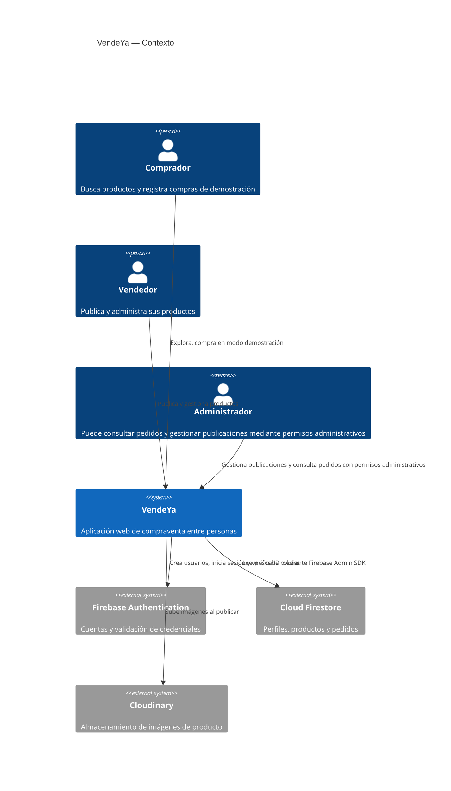

# C1 — Contexto del sistema

La integración de pagos no está conectada; las compras registradas son demostrativas.

## Compartir en Mermaid.ai

1. Abre [Mermaid.ai](https://mermaid.ai) y crea un diagrama nuevo.
2. Copia el bloque Mermaid de cada archivo de esta carpeta en el editor compatible.
3. Revisa el render y usa la opción de compartir/publicar de Mermaid.ai.
4. Pega aquí el enlace público real cuando lo hayas publicado: **Pendiente de publicación**.

No se ha publicado ningún diagrama desde este proyecto.
