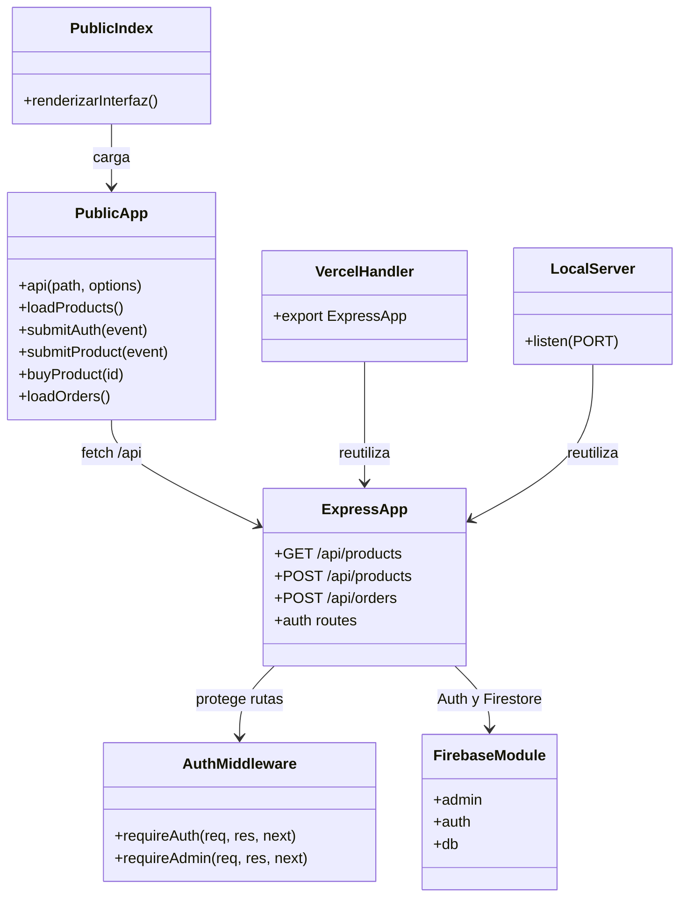

# C4 — Módulos y flujo principal

Mermaid no expresa de forma normativa el nivel C4 de código. Este diagrama de módulos documenta los archivos principales y sus relaciones.

El flujo actual de `POST /api/orders` comprueba disponibilidad y registra una solicitud demostrativa dentro de una transacción Firestore. No cambia el estado del producto, no cobra y guarda `status: demo_request` junto con `paymentStatus: not_integrated`. El producto permanece disponible hasta que exista una pasarela integrada y el pago se confirme en el servidor.
